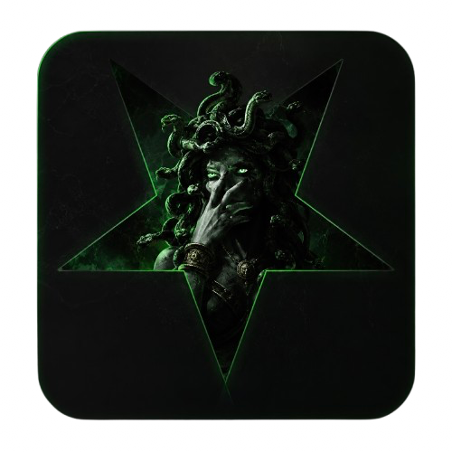
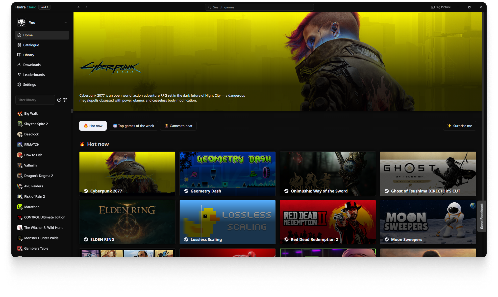

  <h1 align="center">Hydra Launcher</h1>

  

    <strong>Hydra Launcher is an open-source gaming platform created to be the single tool that you need in order to manage your gaming library, from PC games to the classics. Hydra is written in Node.js (Electron, React, Typescript) and Rust, with libtorrent providing the torrent engine.</strong>
  

## Features

### Library

- Add games you own, or any executable as a custom game, and organize them with collections, favorites and pins
- Import your Steam library, playtime and achievements by connecting your Steam account
- Link your Epic Games account to import, install and launch your Epic library
- Scan your drives for games that are already installed
- Track playtime for everything you launch through Hydra
- Customize covers, heroes, logos and icons, or pick artwork from SteamGridDB
- Create desktop and Steam shortcuts for any game

### Catalogue

- Navigate through a rich catalogue with a powerful suggestion algorithm
- Discover new games that you haven't played before
- Read and write reviews, unlocked once you have played a game for a while
- See ProtonDB ratings on Linux before you install

### Downloads

- Built-in download manager with a queue, pause and resume, seeding control and automatic extraction
- Debrid service support for faster downloads

### Hydra Classics

- Point Hydra at your ROM folders and get a matched library with covers, metadata and one-click play
- Works with DuckStation, PCSX2, RPCS3, shadPS4, PPSSPP, Dolphin and RetroArch, and can find or install them for you
- Installs RetroArch cores, checks BIOS and firmware, and installs PS4 PKG files
- Recomps: install community recompiled classics that run natively on PC, then point Hydra to your ROM and play

### Achievements

- Unlock achievements with in-game notifications and a custom unlock sound
- Steam and Epic achievements merged into a single list per game
- RetroAchievements integration for classic games, plus trophy tracking in RPCS3 and shadPS4

### Hydra Cloud

- Save your game progress in the cloud, with automatic sync and conflict resolution
- Cloud saves for emulator games, memory cards included
- Save your achievements on the cloud, then show and compare them with other users
- Souvenirs: a screenshot saved at the moment an achievement unlocks
- Animated profile pictures and banners

### Social

- Have a nice profile that shows what you are playing to your friends, with visibility controls
- Add friends by friend code and chat with them without leaving the launcher
- Capture screenshots with a hotkey or your gamepad, then share them on your profile
- Climb the leaderboards for playtime, achievements, sessions and more

### Everything else

- Big Picture mode for controller-first play on the TV or a handheld
- Decky Loader plugin for Steam Deck
- Run Windows games on Linux through Proton and UMU, with per-game Proton versions, Wine prefixes, Winetricks, GameMode and MangoHud
- Custom themes with a built-in editor and a theme store
- Available in more than 30 languages

## Build from source and contributing

Please, refer to our Documentation pages: [docs.hydralauncher.gg](https://docs.hydralauncher.gg/getting-started)

### Local development requirements

- Node.js + Yarn
- Rust toolchain (for `hydra-native`)
- Git and a C++ toolchain (Visual Studio C++ Build Tools on Windows, GCC/Clang on Linux). The native build obtains CMake and CTest automatically through vcpkg.

After installing dependencies, `postinstall` builds the Rust native addon automatically (`hydra-native/hydra-native.node`).

The native build includes a Rust wrapper around pinned libtorrent. Development and packaged torrenting no longer require Python.

On Windows x64 and Linux x64, the libtorrent bridge comes prebuilt from `native/torrent-bridge/prebuilt`, so installs skip compiling libtorrent through vcpkg. Other platforms build it from source. When a branch push changes `native/torrent-bridge` or `scripts/build-torrent-bridge.cjs`, the "Torrent bridge prebuilts" workflow rebuilds the binaries and commits them to that branch; until then, installs build the bridge from source. Set `HYDRA_TORRENT_BRIDGE_FROM_SOURCE=1` to always build it from source.

## Contributors

## License

Hydra is licensed under the [MIT License](LICENSE).
