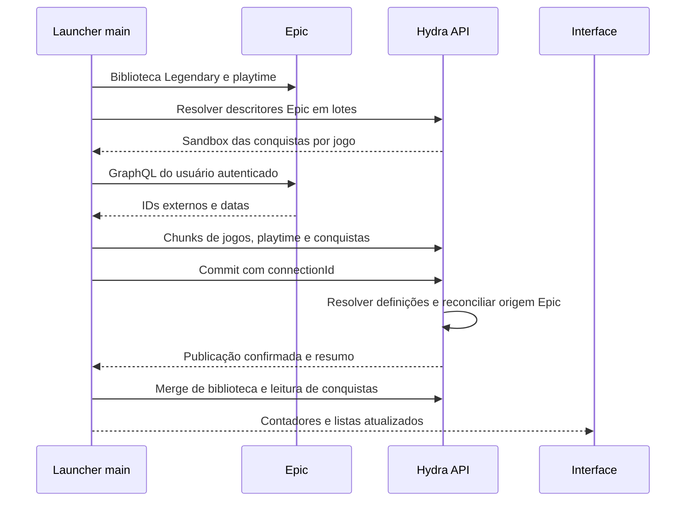

# SDD de sincronização de conquistas Epic no Hydra

Status: proposta de implementação. Data: 14/10/2026.

Base: launcher `codex/epic-download-launch-cloud-saves`, commit `f8e5a1ad1a067621abafca8fb887bff03731f39b`; API `fix/steam-sync-run-delete-indexes`, commit `d297f03a063283206d698713e73aff1ff83a5411`.

O sync Epic deve trazer os desbloqueios do usuário junto com jogos e playtime. A proposta é acrescentar uma etapa de coleta no main process e publicar as conquistas no mesmo snapshot Epic, seguindo a arquitetura da Steam. O backend já fornece as definições Epic, mas precisa aceitar e armazenar os desbloqueios com origem Epic. Portanto, a entrega requer mudanças no launcher e na API; o SDD fica no repositório do launcher.

O transporte recomendado é o GraphQL da loja Epic, autenticado com a sessão Legendary existente. A compatibilidade da consulta com essa sessão, inclusive em perfil privado, precisa passar por uma validação autenticada antes de habilitar a funcionalidade. A análise abaixo confirma código e contratos existentes; não representa um teste de importação contra uma conta real.

## Objetivo e escopo

Na primeira vinculação, no startup e no sync manual, importar biblioteca, playtime e conquistas Epic em uma execução. Exibir os desbloqueios na biblioteca, na página de conquistas e no perfil, preservando loja, conta vinculada e data original.

A primeira entrega cobre conquistas Epic Games Store acessíveis no perfil da loja. Jogos sem esse suporte ou com apenas conquistas EOS próprias continuam importando jogos e tempo. Importação histórica não cria notificações individuais, screenshots, souvenirs ou eventos de desbloqueio local.

Consulta ao abrir a página e após fechar o jogo pode usar o mesmo adapter em uma segunda etapa. Essa extensão não deve consultar conquistas a cada relatório de playtime de 60 segundos. Overlay, detecção instantânea durante o jogo e escrita de conquistas na Epic ficam fora deste escopo.

## Como os syncs funcionam hoje

### Epic

`EpicIntegrationCore` autentica com Legendary, confirma a vinculação no Hydra e persiste a sessão privada. `EpicSessionProvider` serializa o uso do bundle, renova o token e protege a rotação contra respostas de uma conexão antiga.

O fluxo completo em `EpicSyncOrchestrator` é:

```text
capturar conta e conexão → criar ou retomar run
→ Legendary list Windows e Mac → normalizar biblioteca
→ consultar playtime Epic → montar chunks
→ staging Hydra → commit → merge da biblioteca local → finalizar
```

Cada jogo é identificado por `namespace:catalogItemId`. Os `artifactIds` são aliases de execução e de playtime; não são IDs de conquista. A sessão usada na consulta de tempo vem de `EpicSessionProvider.token()`. O serviço consulta `/library/api/public/playtime/account/{epicAccountId}/all` diretamente da máquina do usuário.

O snapshot aceita somente `namespace`, `catalogItemId`, `artifactIds`, `name` e `playTimeInSeconds`. Não existe coleta de conquistas, campo correspondente ou relação `EpicAchievementUnlock`.

| Referência no launcher                                   | Comportamento relevante                                 |
| -------------------------------------------------------- | ------------------------------------------------------- |
| `src/main/services/epic/integration-core.ts:583`         | Login, confirmação do vínculo e persistência da sessão. |
| `src/main/services/epic/session-provider.ts:83` e `:128` | Legendary serializado e acesso ao token no main.        |
| `src/main/services/epic/legendary-sync.ts:140`           | Coleta das bibliotecas Windows e Mac.                   |
| `src/main/services/epic/library-normalizer.ts:65`        | Identidade operacional e agrupamento de artifacts.      |
| `src/main/services/epic/playtime-source.ts:59`           | Consulta Epic com cache e contexto da conta.            |
| `src/main/services/epic/sync-orchestrator.ts:269`        | Sequência de coleta, publicação e merge.                |
| `src/main/services/epic/sync-runtime.ts:125` e `:231`    | Endpoints Hydra e validação do contexto atual.          |
| `src/main/services/epic/sync-runtime.ts:367` e `:575`    | Sync individual e consultas após encerramento.          |

O contexto válido inclui ambiente Hydra, usuário, geração de autenticação, `connectionId` e `epicAccountId`. Logout, troca de conta ou desconexão invalidam a operação. Esses controles também devem proteger a nova coleta.

### Steam

A Steam já executa `biblioteca/playtime → conquistas → snapshot → commit → merge`. A coleta de desbloqueios usa páginas HTML/XML da Steam Community autenticadas e associa cada conquista à chave interna do schema `IPlayerService/GetGameAchievements`. Esse fluxo não usa `ISteamUserStats/GetPlayerAchievements`.

O pool de conquistas tem oito jogos. O scrape Community é condicionado a playtime positivo; o schema é consultado para todos. Essa condição não deve ser copiada para a Epic: playtime ausente ou zero não comprova ausência de conquistas.

`buildSteamSnapshot` publica apenas desbloqueios com timestamp. Campo omitido significa coleta indisponível; array vazio significa zero desbloqueios confirmado. A API mantém a contribuição Steam separada em `SteamAchievementUnlock` e resolve a leitura do usuário a partir das origens disponíveis.

Referências: `src/main/services/steam-integration/steam-sync-orchestrator.ts:687`, `:969`; `steam-community-achievements.ts:278`, `:389`; `steam-web-api.ts:107`; `steam-sync-snapshot.ts:13`, `:50`; API `src/profile-steam/steam-snapshot-publication.service.ts:858` e `prisma/schema.prisma:414`.

Há duas diferenças que impedem copiar o código integralmente. O chunker Steam repete um jogo para dividir listas de conquistas; o protocolo Epic proíbe repetir jogos e artifacts no snapshot. Além disso, o sync Steam escreve unlocks em memória antes do commit; para Epic, o cache visível deve refletir uma publicação confirmada.

### Leitura e desbloqueios locais

`GET /games/{shop}/{objectId}/achievements` fornece o catálogo; `GET /users/{userId}/games/achievements` fornece o estado do usuário. `AchievementMemoryStore` usa a chave `${shop}:${objectId}`, sem escopo de conta. Os timestamps locais são milissegundos; os snapshots usam datas ISO.

O watcher de arquivos só coleta jogos `shop: steam`. `mergeAchievements` é o pipeline de desbloqueios locais: normaliza nomes, usa o endpoint genérico `PUT /profile/games/achievements` e pode criar notificações e souvenirs. No backend, esse endpoint atribui origem Hydra e envolve sessão, assinatura e feed. Ele não deve receber importações Epic.

Mesmo sem arquivos Epic, a leitura atual chama `firstSyncWithRemoteIfNeeded`, que só exclui `custom`, e pode executar `mergeAchievements(game, [], false)`. Esse método envia todos os unlocks já presentes em memória. Portanto, impedir o upload genérico apenas na nova coleta não basta: a primeira reconciliação local deve desviar jogos Epic, mantendo somente leitura remota, e o writer genérico deve impedir que contribuições importadas sejam reenviadas como Hydra. Referências: `src/main/events/user/get-unlocked-achievements.ts:122`; `src/main/services/achievements/achievement-watcher-manager.ts:263`, `:293`; `merge-achievements.ts:363`.

Referências: `src/main/services/achievements/collect-game-achievement-files.ts:46`; `merge-achievements.ts:286`, `:342`, `:374`; `achievement-memory-store.ts:10`; `src/main/events/user/get-unlocked-achievements.ts:26`; API `src/profile-games/profile-game-achievements.service.ts:174`, `:371`.

## Consulta das conquistas na Epic

### Transporte e cobertura

A Epic distingue conquistas EOS de conquistas Epic Games Store. As conquistas da loja são associadas às EOS de um produto; serviços EOS usam identificadores do usuário por produto. Isso não fornece ao Hydra acesso genérico às conquistas privadas de todos os jogos. A cobertura inicial deve acompanhar o perfil da loja. Referências oficiais: [configuração das conquistas da loja](https://dev.epicgames.com/docs/epic-games-store/services/epic-achievements/achievements-setup) e [identidade por produto no EOS](https://dev.epicgames.com/docs/epic-online-services/eos-fundamentals/connect-interface/connect-guide/log-in-with-an-epic-games-account).

O adapter deve fazer `POST https://launcher.store.epicgames.com/graphql`, no main, com `Authorization: Bearer <access_token>` obtido por `EpicSessionProvider.token()`. A implementação pública [EpicApi do Playnite PluginCommon](https://raw.githubusercontent.com/Lacro59/playnite-plugincommon/master/CommonPluginsStores/Epic/EpicApi.cs) consulta desbloqueios nesse endpoint e usa token EG1 para autenticar perfis privados. Ela contém consulta por sandbox e um caminho por produto. O [Legendary 0.21.1](https://github.com/legendary-gl/legendary/blob/0.21.1/legendary/api/egs.py) solicita tokens EG1. Reutilizar o bundle Hydra é, portanto, a hipótese de integração a validar; não exige desenhar um segundo login.

Consulta mínima candidata, baseada nas [operações extraídas do frontend Epic](https://gist.github.com/woctezuma/8ca464a276b15d7dfad475fd6b6cbee9):

```graphql
query PlayerAchievement($epicAccountId: String!, $sandboxId: String!) {
  PlayerAchievement {
    playerAchievementGameRecordsBySandbox(
      epicAccountId: $epicAccountId
      sandboxId: $sandboxId
    ) {
      records {
        totalUnlocked
        playerAchievements {
          playerAchievement {
            epicAccountId
            sandboxId
            achievementSetId
            achievementName
            unlocked
            unlockDate
          }
        }
      }
    }
  }
}
```

Esse GraphQL é um contrato observado do storefront, sujeito a mudanças, e não uma API pública documentada para agregadores. Antes de implementá-lo como caminho habilitado, confirmar formato atual, completude e acesso com a sessão Hydra. Se a operação por sandbox estiver indisponível, validar o caminho `PlayerProfile.playerProfile.productAchievements(productId)` e a resolução explícita de `productId`. Escolher um caminho comprovado; não tentar múltiplas consultas a cada jogo nem fazer fallback silencioso para acesso anônimo.

### Identidade do jogo e do desbloqueio

O namespace executável pode diferir do sandbox das definições. A API já cobre `exec:item → catalogue primary:item` em `src/services/achievement-manager.spec.ts:238`. Consultar sempre o sandbox associado às definições do catálogo Epic resolvido pelo backend.

As definições existentes têm:

```ts
{
  name: "epic_<identificador canônico do Hydra>",
  externalSetId: string, // achievementSetId da Epic
  externalId: string,    // achievementName do desbloqueio
  // textos localizados, ícones e pontos definidos pelo backend
}
```

A API gera/preserva `name` por identidade do catálogo e par externo. O launcher deve transportar `externalSetId` e `externalId` exatamente como recebidos. Não recriar o hash, aplicar uppercase aos IDs externos ou associar por título, tradução, posição, ícone ou identidade Steam.

Referências na API: `src/lambdas/steam-achievements/epic.ts:123`; `src/services/epic-achievement-definitions.ts:72`; `src/services/achievement-manager.ts:273`, `:305`; `src/games/game-achievements.service.ts:80`.

Para disponibilizar o sandbox correto sem milhares de requests individuais, adicionar um endpoint de descritores em lotes, proposta:

```text
POST /profile/integrations/epic/achievement-targets
{ connectionId, objectIds: ["namespace:catalogItemId", ...] } // até 250
→ { targets: [{ objectId, status, achievementSandboxId?, productId? }] }
```

`status` deve distinguir `supported`, `unsupported` e `unavailable`. O servidor resolve cada objeto pela mesma associação executável → catálogo já utilizada pelo import, inclusive para jogos recém-coletados ainda não publicados. O descritor não comprova posse; a publicação mantém seus controles próprios. Associação ausente ou ambígua não usa aproximação por nome. Como o catálogo atual retorna um array de conquistas sem esse descritor, esta é uma adição de contrato, não uma capacidade já disponível.

Deduplicar consultas pelo sandbox, mantendo o vínculo com cada objeto operacional. O mesmo resultado só pode ser aplicado a objetos cuja associação foi confirmada pelo backend.

## Arquitetura proposta no launcher



Criar `src/main/services/epic/achievement-source.ts` para transporte e coleta, `achievement-protocol.ts` para validar resposta GraphQL e `achievement-normalizer.ts` para normalizar os desbloqueios. Usar dependências injetáveis de fetch, relógio, sessão e espera, seguindo o padrão de `EpicPlaytimeSource`.

Acrescentar `deps.achievements(context, games, signal, progress)` entre a aplicação de playtime e `buildEpicSnapshotChunks` em `sync-orchestrator.ts:275`. `EpicSyncRuntime` fornece descritores e fonte. A nova etapa retorna jogos enriquecidos e um resumo, sem gravar unlocks visíveis antes da publicação.

Não envolver toda a coleta em `session.serialize()` e chamar `session.token()` de dentro desse lease: a renovação também usa a fila e pode bloquear a própria operação. Obter tokens pelo provider; compartilhar uma renovação em andamento para evitar que falhas simultâneas forcem vários refreshes.

### Resposta completa e erros

Publicar somente entradas `unlocked: true`, com par externo não vazio e `unlockDate` válida, normalizada para ISO UTC. Conferir conta e sandbox retornados quando presentes, estrutura de records e duplicidade exata do par. Não converter progresso ou XP em desbloqueio e não criar uma data com `Date.now()`.

Resposta vazia só produz `[]` quando o adapter comprova que a consulta completa representa zero desbloqueios. `null`, campo ausente, erro de privacidade ou GraphQL `errors` não são zero. Se houver unlock com data inválida, ID ausente, pares conflitantes ou resposta truncada, preservar a contribuição anterior daquele jogo e marcar coleta incompleta. Não publicar uma lista filtrada como snapshot autoritativo.

Não há paginação de conquistas comprovada no código analisado. A validação inicial deve confirmar se o retorno é completo e como consultar páginas quando aplicável. Se houver paginação, limitar páginas, itens e bytes, rejeitar cursores repetidos e produzir resultado autoritativo somente após concluir todas as páginas. Não inventar parâmetros `cursor` ou `page` para a operação candidata.

Reutilizar `fetchEpicWithRetry` para HTTP: um refresh após 401, até três tentativas de rede/5xx e até cinco em 429, respeitando `Retry-After`. Acrescentar classificação de erros dentro de HTTP 200: sessão expirada, permissão, limite, schema incompatível e resposta inválida. HTTP 403 isolado não força novo login; 401 persistente interrompe a coleta restante e sinaliza reconexão.

Falhas na facet de conquistas não impedem publicar biblioteca/playtime já coletados. Os jogos afetados levam `achievements: null`; os demais mantêm seus resultados válidos. Aborto solicitado, logout ou troca de contexto interrompem a operação inteira e seguem as regras existentes de staging e commit.

### Orçamento e tamanho

Proposta inicial: quatro consultas simultâneas, timeout de 15 segundos por request e orçamento total de 90 segundos para conquistas, limitado pelo tempo restante do sync de cinco minutos. Reservar tempo para staging, commit e merge. Ao esgotar o orçamento, interromper workers de conquistas com um controller próprio e publicar jogos/playtime; jogos não concluídos preservam a facet anterior. Separar esse timeout de um cancelamento do usuário.

Primeiro sync considera todos os sandboxes suportados, mesmo com playtime zero. Para bibliotecas que não cabem no orçamento, manter uma fila de pendências escopada à conexão e priorizá-la no próximo sync, evitando consultar sempre os primeiros jogos. Sync manual força consulta fresca; cache de transporte não transforma falha em sucesso.

Limites existentes: 10.000 jogos, 250 jogos/chunk, 100 chunks, 1 MiB/chunk e 16 artifacts/jogo. Propor limites novos compartilhados de 2.000 unlocks/jogo, 100.000 unlocks/snapshot e 255 caracteres por componente externo; confirmar sua suficiência com fixtures reais na primeira etapa. IDs maiores não devem ser truncados.

O chunker mede o JSON completo em UTF-8. Se uma facet exceder um limite, publicar esse jogo sem a facet e registrar resultado parcial. Se as facets fizerem o snapshot ultrapassar 100 chunks, omitir facets de forma determinística até que o snapshot de biblioteca válido caiba. Nunca repetir o objeto Epic para fragmentá-lo. Uma biblioteca que exceda os limites mesmo sem conquistas mantém o erro atual de snapshot.

### Retomada

Manter staging/commit existentes. Em run PENDING, recoletar e reenviar todos os índices; `stage()` substitui o payload completo do índice via upsert. Se `totalChunks` mudar, cancelar staging e criar novo run. Fazer commit somente depois de todos os índices da nova coleta terem sido enviados, evitando misturar versões.

Em SUCCEEDED, retomar somente o merge local, sem nova coleta Epic. Persistir o resumo de conquistas no journal ou recuperá-lo do run para reportar corretamente uma execução parcial após crash. Falha de merge local não desfaz uma publicação confirmada.

## Contrato e persistência necessários na API

### Snapshot

Estender os tipos do launcher e `src/validation/profile-epic-sync.validation.ts` com:

```ts
interface EpicSnapshotAchievement {
  externalSetId: string;
  externalId: string;
  unlockTime: string; // ISO UTC validada
}

interface EpicSnapshotGame {
  namespace: string;
  catalogItemId: string;
  artifactIds: string[];
  name: string;
  playTimeInSeconds: number;
  achievements?: EpicSnapshotAchievement[] | null;
}
```

| Campo de conquistas | Semântica do snapshot completo                                                                                                                   |
| ------------------- | ------------------------------------------------------------------------------------------------------------------------------------------------ |
| Omitido ou `null`   | Não houve coleta completa; preservar contribuição Epic anterior.                                                                                 |
| `[]`                | Coleta completa com zero desbloqueios; remover somente a contribuição Epic deste jogo/conexão, respeitando atualizações posteriores ao snapshot. |
| Lista               | Reconciliar a contribuição Epic com os desbloqueios confirmados, preservando outras origens.                                                     |

Os endpoints de start, chunks e commit continuam os mesmos. `epicSnapshotGameSchema` e `epicIndividualSyncSchema` atuais são strict; enviar o novo campo ao backend antigo faz o sync falhar.

Adicionar uma capability opcional, proposta `capabilities.achievementsSnapshotVersion: 1`, na resposta da integração. Sem capability, o launcher mantém o payload atual e não inicia coleta nem envia campos novos. Publicar backend antes do launcher. O campo deve ser opcional para clientes e servidores anteriores; não fazer fallback depois de um commit de resultado incerto.

Cliente habilitado também envia `achievementSnapshotVersion: 1` como campo opcional no start do run, para distinguir importação solicitada de execução de um cliente antigo. Persistir no `EpicSyncRun` um resumo de aplicação, proposta `achievementSummary: { status: "not-requested" | "complete" | "partial", gamesApplied, gamesPending, gamesUnsupported, unlocksApplied }`, exposto opcionalmente no `GET /profile/integrations/epic/sync/{runId}`. Contadores de aplicação são calculados pelo servidor; o resumo local da coleta complementa o resultado, sem declarar que pares recusados foram importados. Não é necessário mudar o HTTP 204 do commit: após confirmação, o launcher consulta o run, inclusive ao retomar SUCCEEDED. O journal não substitui esse resultado persistido.

### Proveniência e resolução de definições

Criar `EpicAchievementUnlock` relacionado a `EpicConnection` e `GameAchievement`, com unicidade por `(connectionId, gameAchievementId)`, `unlockTime`, timestamps e identificação do último run quando necessária à reconciliação. O `GameAchievement` permanece a linha unificada do jogo; a nova relação distingue a contribuição importada.

O backend resolve cada par externo pelo catálogo Epic associado ao objeto executável e usa o `name` canônico existente. Textos, pontos e IDs internos não vêm do launcher. As definições Epic podem estar em `GameCatalogue.storeMetadata.epicAchievementDefinitions`; não assumir que estão sempre em `GameCatalogueAchievement` nem reutilizar diretamente a agregação Steam por `(shop, objectId, name)`.

Resolver/carregar definições antes da transação de publicação, com tempo limitado, e aplicar dados já preparados dentro do commit. Se as definições estiverem indisponíveis ou um par não puder ser associado com segurança, preservar toda a contribuição anterior do jogo e registrar pendência para nova consulta. Isso evita apagar unlocks por atraso de catálogo e mantém a publicação de jogos/playtime independente de indisponibilidade externa. O resumo do commit distingue consulta bem-sucedida de aplicação efetiva.

Antes dessa preparação, validar os chunks e mover o run para RUNNING sob lock, congelando o upload conforme o protocolo atual. Capturar catálogo, sandbox e revisão ou fingerprint das definições usadas. Dentro da transação final, revalidar conexão e associação executável → catálogo → sandbox e garantir que a revisão preparada ainda corresponde à identidade aplicada. Se a associação mudar, preservar a facet anterior e reagendar sua coleta; não aplicar nomes preparados para outro catálogo. Requests Epic ou de catálogo não devem manter uma transação de banco aberta.

Reconciliação deve preservar contribuições atualizadas após a criação do run, seguindo a ideia de `src/profile-steam/steam-snapshot-delta.ts:145`. Um snapshot antigo não pode apagar um unlock importado por uma operação individual mais recente. Commit repetido de SUCCEEDED continua idempotente.

### Leituras e ciclo de vida

Adicionar Epic às consultas de desbloqueios, timestamps, `unlockedOn`, contadores, pontos, estatísticas, comparação e Swagger. Contribuição Epic ativa deve aparecer independentemente de assinatura Hydra. Se um unlock existir em mais de uma origem no mesmo jogo, contar uma vez e expor as origens; não somar XP bruto enviado pela Epic aos pontos Hydra.

Desconexão, troca de vínculo e remoção de import excluem somente as contribuições da conexão Epic e recalculam os agregados. Reset de conquistas locais preserva contribuições importadas. Remover linhas órfãs apenas quando não há outra origem ou dado local que justifique mantê-las. `claimUnassignedAchievements` hoje associa qualquer linha sem sessão; excluir importações externas desse claim para não transformá-las em conquistas Hydra.

| Arquivo na API                                                      | Alteração esperada                                       |
| ------------------------------------------------------------------- | -------------------------------------------------------- |
| `src/validation/profile-epic-sync.validation.ts:43`                 | Schema dos unlocks, limites e campo opcional.            |
| `src/profile-epic/epic-snapshot-publication.service.ts:40` e `:203` | Aplicação da facet, resumo, proveniência e concorrência. |
| `src/repository/epic-executable-catalogue.ts:4`                     | Reuso da associação exata ao catálogo.                   |
| `prisma/schema.prisma:586` e `:1765`                                | Relação Epic com GameAchievement e conexão.              |
| `src/helpers/game-achievement-platform-helper.ts:1`                 | Origem Epic em `unlockedOn`.                             |
| `src/profile-games/handlers/get-game.ts:75`                         | Visibilidade e contadores do import.                     |
| `src/users/users.service.ts:137` e `user-stats-aggregation.ts:14`   | Listas, comparações e estatísticas.                      |
| `src/profile-epic/epic-import-cleanup.ts:7`                         | Remoção da contribuição Epic e recálculo.                |
| `src/profile-games/profile-game-achievements.service.ts:978`        | Reset/delete preservando importações.                    |
| `src/services/achievement-session-service.ts:7`                     | Impedir atribuição indevida de sessão Hydra.             |

## Cache e apresentação no launcher

Após commit confirmado e merge, invalidar o estado Epic afetado e buscar a resposta Hydra sob o contexto capturado. O cache da fonte deve ter ambiente, usuário/generation, conexão, conta Epic e sandbox na chave. O estado visível só recebe nomes canônicos da API, com datas convertidas para milissegundos.

O cache genérico atual não distingue contas nem proveniência. Para unlocks importados Epic, usar uma camada escopada ou acrescentar proveniência ao cache; em ambos os casos, invalidar os dados ao mudar o owner. Não guardar raw IDs Epic no array genérico de nomes canônicos.

O merge atual é uma união de unlocks e os totais usam `Math.max(local, remote)`. Isso mantém dados antigos mesmo após um `[]` autoritativo ou desconexão. A atualização Epic precisa substituir sua contribuição e permitir diminuir contagens, preservando apenas contribuições locais independentes. Reads assíncronos devem conferir owner antes de escrever cache ou emitir evento. Se a leitura remota falhar após o commit, manter atualização pendente e tentar no próximo acesso, sem apresentar unlocks não publicados.

Ampliar `SteamAchievement` com metadados externos opcionais ou extrair um tipo genérico compatível; adicionar `"epic"` a `UserAchievement.source`. `getUnlockedAchievements` hoje reconstrói itens sem conservar a origem remota; preservar esse campo na composição de resultados e nas comparações.

No agrupamento por `canonicalId`, a apresentação prioriza catálogo Steam. Os contadores vêm de `presentationGame`, enquanto a página lê conquistas de `operationalGame`. Definir uma identidade compartilhada `achievementGame`, inicialmente igual ao membro operacional, e usar a mesma identidade para contador, lista e eventos. Quando houver dois membros, oferecer escolha Steam/Epic na página de conquistas, default no membro operacional. Não somar conquistas das lojas nem converter IDs entre elas.

Referências: `src/shared/library-catalogue.ts:106`, `:155`; `src/renderer/src/context/game-details/game-details.context.tsx:124`, `:222`, `:478`; `src/main/services/achievements/merge-unlocked-achievements.ts:3`; `achievement-memory-store.ts:102`; `src/types/game.types.ts:26`. Aplicar a mesma seleção no Big Picture.

Adicionar phase `"achievements"` a `EpicSyncPhase` e resumo de facet em state/finished, com jogos processados, aplicados, não suportados e pendentes. `ok` continua indicando publicação/merge de biblioteca; o resumo identifica `complete`, `partial` ou `unavailable` para conquistas. Um problema de sessão na facet pode exigir reconnect mesmo com biblioteca publicada.

Reusar IPC existente, sem expor tokens ou bundle. Settings mostra progresso e um único resultado manual, por exemplo: “Jogos e tempo sincronizados; conquistas de 2 jogos serão tentadas novamente.” Não gerar um toast para cada conquista histórica. Atualizar traduções, renderer e Big Picture; a mensagem atual de `source-permission` cita especificamente playtime e não descreve a nova facet.

## Extensão posterior do sync individual

Ampliar `PUT /profile/integrations/epic/games/{objectId}` com a mesma facet externa e suporte a atualização somente de conquistas quando o playtime não puder ser consultado. Hoje playtime é obrigatório e `syncGame` retorna cedo se não há total do artifact (`sync-runtime.ts:410`); isso precisa mudar para a extensão funcionar.

Escolher reconciliação autoritativa por jogo para Epic, com a mesma semântica `null`/`[]`/lista do snapshot. A Steam individual é aditiva, portanto não copiar sua semântica sem adaptação. Adicionar ordenação/revisão de observação no servidor para uma resposta antiga não substituir estado mais recente.

Separar origem/facets no runtime: página e saída podem consultar conquistas; confirmação de relatório periódico executa somente playtime. Deduplicar por jogo e contexto, aguardar o full sync e usar os delays de saída existentes de 10 e 30 segundos, cancelando se o jogo reabrir. Essa etapa usa a mesma persistência Epic e não o endpoint genérico de unlocks Hydra.

## Plano de implementação e validação

1. **Validar o transporte Epic.** Fazer consulta de leitura com sessão Legendary do Hydra em perfil privado e público, um jogo com unlocks conhecidos, zero unlocks, jogo sem conquistas da loja e jogo com mais de um set. Confirmar IDs, datas, conta, sandbox, completude e eventual paginação. Capturar fixtures sanitizadas. Só habilitar a capability após esse resultado; se a sessão não tiver acesso, manter a facet indisponível até validar uma alternativa de autenticação.
2. **Entregar o contrato backend.** Descritores em lote, capability, schema, migration de proveniência, preparação das definições, reconciliação atômica, leituras, agregações e cleanup. Clients antigos seguem publicando jogos/playtime sem conquistas.
3. **Integrar o launcher.** Fonte/parser/normalizador, etapa do orchestrator, limites, orçamento, journal, resultado parcial e invalidação de cache após commit.
4. **Alinhar a interface.** Origem Epic, identidade de conquistas nos grupos, contadores/listas, traduções e Big Picture.
5. **Habilitar e acompanhar.** Medir cobertura de jogos suportados, duração, rate limits, falhas de associação e pendências aplicadas. Registrar apenas códigos e métricas necessários; não incluir tokens, cookies ou respostas privadas em logs. Manter a capability como controle de compatibilidade e desativação.
6. **Estender página/saída.** Adicionar a facet individual após o sync completo passar nos cenários anteriores.

| Cenário de aceitação                                      | Resultado exigido                                                                          |
| --------------------------------------------------------- | ------------------------------------------------------------------------------------------ |
| Primeira vinculação com unlocks conhecidos                | Jogos, playtime e conquistas aparecem com data original e origem Epic.                     |
| Jogo com playtime zero ou ausente                         | A coleta de conquistas ocorre independentemente do tempo.                                  |
| Dois sets com o mesmo achievementName                     | Ambos associados pelo par externo correto.                                                 |
| Executável em namespace diferente do catálogo             | Consulta o sandbox confirmado das definições.                                              |
| Perfil privado com sessão válida                          | Importa sem exigir publicação do perfil.                                                   |
| Sem suporte, null, erro GraphQL ou schema alterado        | Preserva unlocks anteriores e publica biblioteca/playtime.                                 |
| Zero unlocks confirmado                                   | `[]` remove apenas a contribuição Epic autoritativa.                                       |
| ID/data inválida, resposta incompleta ou par desconhecido | Não publica lista parcial como substituição completa.                                      |
| 401, 403, 429, timeout e orçamento esgotado               | Retry limitado, resultado parcial correto e pendências preservadas.                        |
| Snapshot grande                                           | Respeita bytes/quantidade sem duplicar jogo nem perder jogos/playtime por facet excessiva. |
| Cancelamento antes/depois do commit                       | Staging cancelado ou publicação confirmada reconciliada conforme estado real.              |
| Crash em staging, commit ou merge                         | Retomada sem misturar chunks e sem reaplicar commit concluído.                             |
| Logout/troca de conta durante request                     | Resposta antiga não escreve cache, banco local ou UI da nova conta.                        |
| Snapshot antigo versus sync individual novo               | Preserva atualização mais recente.                                                         |
| Desconectar Epic com unlock local no mesmo jogo           | Remove origem Epic e conserva dados Hydra/Steam válidos.                                   |
| Epic e Steam no mesmo grupo canônico                      | Contadores e lista usam a mesma loja; IDs não são misturados.                              |
| Abrir página após importar conquistas Epic                | Não faz PUT genérico de conquistas nem cria origem Hydra para o import.                    |
| Catálogo ou sandbox muda durante preparação do commit     | Facet preservada e reagendada, sem aplicar definições da associação antiga.                |
| Retomar run concluído com pendência de aplicação na API   | GET run recupera o resumo parcial real; launcher não anuncia importação completa.          |
| Repetir sync sem mudanças                                 | Sem duplicatas, screenshots, souvenirs ou notificações históricas.                         |
| Sem assinatura Hydra                                      | Conquistas Epic importadas continuam visíveis.                                             |
| API anterior sem capability                               | Sync atual funciona e nenhum campo novo é enviado.                                         |

Usar fixtures para parser e contratos; mocks para retries, cancelamento, journal e troca de contexto; testes de integração da API para publicação/proveniência/leituras. Validar manualmente listas e contadores em renderer e Big Picture. Na implementação, executar os testes focados, typecheck e verificação de bridge OTA quando houver mudança nos tipos IPC/preload.

## Decisões para iniciar o desenvolvimento

O trabalho pode seguir com coleta no main e publicação no snapshot, mantendo Legendary como dono da sessão e a API como dona dos nomes canônicos. Os pontos que condicionam a habilitação são: consulta autenticada comprovada, resolução do sandbox correto, contrato backend com proveniência Epic e cache capaz de remover contribuições antigas.

O requisito central é importar os desbloqueios durante o sync atual. Preparar launch/overlay não substitui essa importação, e chamar o pipeline genérico de conquistas locais não preserva a origem necessária.
