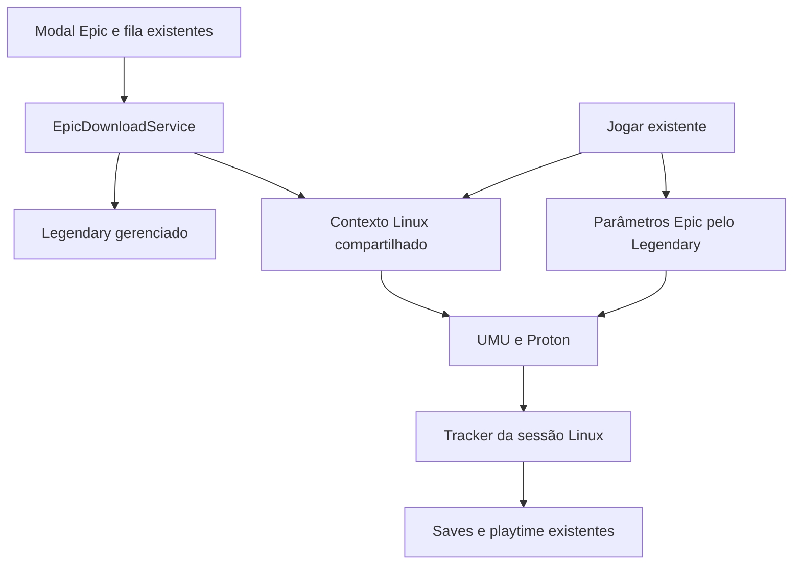

# Epic Games no Linux com Legendary e UMU

SDD para implementação em 14 de outubro de 2026. Status: desenho fechado; implementação e aceite real no Linux pendentes.

Base: launcher `a4dfafb6621fc4e274158db59604dcdccc41a244`, branch `codex/epic-achievements-sync`. Esta especificação complementa `docs/epic-download-launch-cloud-saves-sdd.md` e substitui, para o alvo abaixo, a decisão anterior de manter a instalação gerenciada restrita ao Windows.

## Resultado esperado

Um usuário Linux escolhe Epic Games no seletor atual, escolhe a pasta, baixa pela fila do Hydra e clica em Jogar. A preparação do Proton, do prefixo e das dependências acontece automaticamente. A experiência usa os mesmos modais, controles de download, janela de preparação e opções de compatibilidade já existentes. Conta Epic, autenticação de lançamento, instalação, saves e acompanhamento da sessão continuam sob o controle do Hydra.

O alvo de execução desta entrega é Linux x86_64, incluindo Steam Deck. A distribuição Linux atual é construída pelo job Ubuntu x64; uma versão ARM64 do Legendary, isoladamente, não comprova execução dos jogos Windows nesse hardware. Conexão e importação existentes em outras arquiteturas continuam disponíveis. Tradução de arquitetura, lançamento Epic em macOS, gerenciamento novo de DLCs e atualização automática de jogos não fazem parte desta entrega. A compatibilidade de cada jogo com Proton, DRM e anticheat continua determinando se ele executa; o fluxo precisa distinguir uma falha do jogo de uma falha da integração.

## Decisões de implementação

| Assunto                        | Decisão                                                                                                                                                         |
| ------------------------------ | --------------------------------------------------------------------------------------------------------------------------------------------------------------- |
| Download                       | Manter Legendary 0.21.1 e seu workspace gerenciado atual. Linux baixa o build Epic `Windows`.                                                                   |
| Execução                       | Legendary produz parâmetros com `launch --json --no-wine`; Hydra os executa pelo UMU.                                                                           |
| UMU                            | Reutilizar o pacote, o updater e o monitor existentes, acrescentando uma API de processo supervisionado.                                                        |
| Proton                         | Versão válida escolhida no jogo, depois padrão global válido, depois `UMU-Proton` gerenciado pelo UMU. A preparação automática passa esse token explicitamente. |
| Instalação de Proton e runtime | UMU faz o provisionamento; Hydra não cria outro downloader de Proton e não exige Steam instalado.                                                               |
| Python                         | Reutilizar o `python-runner` privado já distribuído para o Legendary Linux. Python de sistema deixa de ser requisito deste fluxo.                               |
| Prefixo                        | Reutilizar seleção e raiz configuradas no Hydra; novos prefixos Epic têm identidade estável por conta e artefato.                                               |
| Pré-requisitos                 | Executar no mesmo prefixo e Proton, com resultado Windows completo coletado por um pequeno supervisor PE incluído no pacote.                                    |
| Interface                      | Nenhuma nova tela. Somente estados, mensagens e correções nos controles atuais.                                                                                 |
| Saves e sessão                 | Preparar prefixo antes do restore; acompanhar o processo Windows real no Linux antes de contar tempo ou enviar saves.                                           |
| Backend                        | Nenhum endpoint, migration ou alteração de identidade de biblioteca necessário.                                                                                 |

O Proton é escolhido uma vez por operação e convertido em caminho absoluto. Preparação, pré-requisitos e lançamento não podem resolver versões diferentes no meio do mesmo fluxo. A opção Automático mantém a usabilidade atual; sua última alternativa nesta integração é explicitamente `UMU-Proton`, sem depender do default implícito de uma versão do UMU.

## Comportamento na interface

### Baixar

O seletor oferece Epic quando existe posse importada no escopo atual e o main informa suporte à instalação gerenciada. O modal atual mostra os tamanhos, permite escolher diretório e inicia ou enfileira o download. Não há seleção de Wine, Proton ou prefixo nesse modal.

O download usa a lista e o slot atuais. Quando os arquivos terminarem, a fase existente `prerequisites` também representa a preparação necessária da compatibilidade. O rótulo dessa fase passa a ser neutro, como “Preparando instalação”. Bytes em 100% com preparação pendente continuam sendo uma instalação ativa. Concluir exige validar os arquivos, preparar o ambiente, resolver os pré-requisitos e associar a instalação.

Pausa, cancelamento, retomada e erro continuam nas ações atuais. Uma falha ao baixar o Proton ou instalar uma dependência permite tentar novamente a finalização, reaproveitando os arquivos do jogo.

### Jogar

Jogar usa o membro Epic operacional já instalado, inclusive quando a página apresenta dados Steam. Abre a janela de preparação atual. Ela apresenta o estado existente de preparação da compatibilidade, depois os estados de saves e de início do jogo. Proton e prefixo continuam configuráveis nas seções atuais de compatibilidade, no desktop e no Big Picture.

Sem configuração manual, o primeiro uso baixa o runtime necessário automaticamente. Sem rede e sem runtime em cache, a janela existente explica que a primeira preparação precisa de conexão e permite tentar novamente. Se o runtime já existir e o jogo permitir offline, jogar offline usa o mesmo prefixo, preserva saves locais e mantém o envio remoto pendente.

Não acrescentar wizard, login Epic adicional, importação pelo Heroic, escolha obrigatória de versão, tela de instalação de Proton ou seletor de executável para instalações comprovadas pelo manifesto. Conflito real de save continua usando o modal de conflito existente. Erros de permissão, prefixo inválido ou dependência do host aparecem no fluxo atual, com a ação pertinente, sem exigir terminal como parte do caminho normal.

## Evidência na base atual

As referências de linha abaixo correspondem ao commit-base e orientam a implementação.

| Local                                                                       | Comportamento atual                                                                                    | Alteração necessária                                                               |
| --------------------------------------------------------------------------- | ------------------------------------------------------------------------------------------------------ | ---------------------------------------------------------------------------------- |
| `src/main/services/epic/installation.ts:315,393,480`                        | Bloqueia qualquer host diferente de `win32` antes de consultar opções.                                 | Política única de host, arquitetura e build; permitir Linux x64 com build Windows. |
| `src/renderer/src/hooks/use-epic-managed.ts:13`                             | Disponibilidade verifica apenas funções IPC.                                                           | Consumir suporte à instalação informado pelo main.                                 |
| `src/main/services/epic/download.ts:497,540,573`                            | Recupera build existente, valida arquivos, executa pré-requisito e faz bind.                           | Preservar o fluxo; acrescentar preparação Linux e pré-requisito por prefixo.       |
| `src/main/helpers/launch-game.ts:254,519,758`                               | Já resolve Proton do jogo/global, prepara prefixo e calcula contexto Linux.                            | Extrair resolução compartilhada para download, lançamento e saves Epic.            |
| `src/main/helpers/launch-game.ts:649,783`                                   | Epic faz `spawn` direto do executável e ignora o runner Linux.                                         | Despachar pelo UMU preservando o payload autenticado.                              |
| `src/main/services/umu.ts:366`                                              | Retorna `void`, fixa diretório, registra argv/ambiente e ativa `PROTON_LOG`.                           | API com handle, cwd, ambiente, cancelamento e diagnóstico seguro.                  |
| `src/main/services/epic/launch-protocol.ts:28`                              | Exige `launch_command` vazio.                                                                          | Manter a garantia; wrapper não entra pelo JSON Legendary.                          |
| `src/main/services/epic/managed-process-tracker.ts:15`                      | Considera executável do host dentro da instalação; intermediários externos deixam inspeção incompleta. | Prova específica de processo Windows executado por Proton.                         |
| `src/main/services/native-addon.ts:156`                                     | `processTree` descarta contexto Linux útil.                                                            | Projeção mínima com identidade e dados de atribuição, sem argv/ambiente completo.  |
| `src/main/services/process-watcher.ts:402`                                  | Match heurístico pode prevalecer sobre o tracker Epic.                                                 | Tracker gerenciado autoritativo para sessões Epic iniciadas pelo Hydra.            |
| `src/main/services/epic/cloud-saves.ts:178,244,274`                         | Prefixo implícito pode cair no home Linux em consultas e sync manual.                                  | Usar o mesmo resolvedor de prefixo em todas as operações.                          |
| `resources/legendary/linux-python.sh`, `src/shared/legendary-manifest.json` | Runtime Python privado já existe e é verificado no pacote.                                             | Expor seus caminhos para UMU sem passar pelo wrapper Legendary.                    |

O bloqueio inicial foi reproduzido por injeção de host Linux: `getOptions()` retorna `{ options: [], error: "unsupported-platform" }` antes de capturar a conta. Isso explica os tamanhos vazios; não é uma falha de download do Legendary.

## Responsabilidades e contratos



`installation.ts` continua responsável por identidade, posse, metadados, instalação e paths. `download.ts` conserva a fila e a finalização. `epic/launch.ts` conserva autenticação e identidade da sessão. `umu.ts` executa processos; não conhece contas Epic nem publica dados de biblioteca. O tracker decide atividade e encerramento; o serviço de saves conserva conflito, backup, restore e verificação remota atuais.

Extrair de `launch-game.ts` a resolução comum de Proton/prefixo para um serviço pequeno de compatibilidade Linux. Acrescentar `src/main/services/epic/linux-runtime.ts` para coordenar essa resolução com owner, artefato, preparação e recibos Epic. Evitar dependência circular entre helpers de lançamento e serviços Epic.

Contratos internos propostos:

```ts
interface PreparedEpicLinuxContext {
  pythonRunnerPath: string;
  umuBinaryPath: string;
  umuVersion: string;
  protonPath: string; // caminho absoluto efetivo
  protonFingerprint: string;
  winePrefixPath: string; // prefixo Wine canônico
  prefixGeneration: string;
  gameId: string; // umu ID comprovado ou umu-default
  store: "egs";
}

interface UmuProcessHandle {
  pid: number;
  invocationId: string;
  exited: Promise<{
    code: number | null;
    signal: NodeJS.Signals | null;
  }>; // saída do wrapper, não prova isolada de fechamento do jogo
  terminate(): Promise<void>; // termina e confirma a árvore desta invocação
}
```

A nova entrada supervisionada do UMU recebe executável, `args: string[]`, cwd, ambiente validado, contexto preparado, finalidade (`game`, `prerequisite` ou `prepare`), `AbortSignal` e callbacks de estado. Retorna o handle ao observar `spawn`, sem esperar três segundos para registrar a sessão. O comportamento público atual de `Umu.launchExecutable` pode permanecer como adaptador para os consumidores existentes.

O callback de pré-requisito passa a receber `{ game, target, installed, executable, args, signal }`, permitindo escolher prefixo e owner. O ramo Windows continua usando seu executor e UAC atuais. Os DTOs de iniciar download e jogar permanecem suficientes; caminhos privados, handles e parâmetros autenticados não atravessam IPC.

## Suporte de plataforma e compatibilidade OTA

Centralizar a decisão de suporte no main, usada em opções, enqueue, prepare, read/repair e launch. Nesta entrega: Windows nos alvos já suportados e Linux x64 com build `Windows`. Não criar `EpicInstallPlatform = "Linux"` e não liberar `Mac` como consequência da remoção do guard.

Acrescentar um campo opcional local a `EpicConnectionState`:

```ts
managedInstallation?: {
  available: boolean;
  reason?: EpicInstallError;
};
```

Esse campo usa o IPC/evento de conexão existente, mas descreve instalação separadamente de login/importação. A ausência de Proton baixado não torna a plataforma indisponível: ela exige preparação recuperável. Falta de arquivo obrigatório no pacote deve gerar erro de runtime, não erro de credencial.

Desktop e Big Picture compartilham a checagem. Em main antigo sem o campo, o renderer mantém o comportamento legado Windows e trata Linux como dependente de atualização do aplicativo. Não inferir suporte Linux apenas da presença dos IPCs. O main sempre revalida; a UI não é uma barreira de segurança. A entrega exige pacote nativo atualizado, pois renderer OTA sozinho não altera serviço, Python, supervisor ou addon.

## Runtime e escolha do Proton

### Python e UMU distribuídos

Manter Legendary 0.21.1 e o bundle Linux já descrito no manifesto: CPython 3.13.16, release 20261003, e glibc privada com hashes. Expor um resolvedor de caminhos que devolva o `python-runner` ao lado desse runtime. Invocar `python-runner <umu-run> ...` diretamente. O wrapper `legendary` altera o cache para seu workspace e não deve ser usado para iniciar UMU.

O loader privado recebe `--library-path` somente nessa execução, sem exportar `LD_LIBRARY_PATH` para o jogo. O zipapp UMU distribuído contém suas dependências Python. O pacote deve passar por smoke real de imports, HTTPS e execução; a compatibilidade estática desses arquivos não substitui esse teste.

Preservar o updater UMU e a seleção de binário gerenciado quando houver adaptador de protocolo validado para aquela versão. Inicialmente, o contrato é o UMU 1.4.4 distribuído. Uma versão gerenciada sem contrato conhecido usa o 1.4.4 incluído, sem bloquear o usuário por um update automático ainda não homologado. Fixar o caminho/versão do binário enquanto a operação existir; a limpeza de versões antigas não pode remover arquivos em uso.

### Resolução automática sem outro gerenciador

A prioridade é `game.protonPath` válido, `defaultProtonPath` válido e, por último, o token explícito `UMU-Proton`. Reutilizar validação e descoberta existentes. Um path removido segue a resolução válida seguinte, como no Hydra atual; uma operação já preparada não troca de runner silenciosamente.

UMU faz download e validação do Proton e do Steam Linux Runtime, conforme o [gerenciador de Proton 1.4.4](https://github.com/Open-Wine-Components/umu-launcher/blob/1.4.4/umu/umu_proton.py). Não consultar releases do GE-Proton em um segundo serviço. Um Proton customizado continua selecionável pelos controles existentes e precisa satisfazer os requisitos do UMU utilizado.

Para fixar o caminho efetivo da seleção automática, executar `createprefix` sem autenticação Epic, com `UMU_LOG=debug` capturado exclusivamente em pipe privado. O adaptador do UMU 1.4.4 extrai apenas a atribuição final `PROTONPATH=<caminho absoluto>` emitida após a resolução. Validar `realpath`, `proton`, `toolmanifest.vdf` e identidade da versão; descartar o restante da saída. Não persistir dump de ambiente, escolher a primeira pasta encontrada nem depender do nome de um symlink mutável.

Nota da implementação: o smoke do UMU 1.4.4 confirmou que `createprefix` pode preparar o prefixo e retornar `1` pela ausência de um executável. O bootstrap usa o supervisor distribuído em modo `--probe`, sem autenticação e com saída `0` comprovada, mantendo a resolução privada de `PROTONPATH` e evitando aceitar um código de falha ambíguo.

Esse diagnóstico não é uma API JSON pública: mantê-lo isolado, versionado e coberto por fixture do zipapp distribuído. Prefixo válido sem runner efetivo comprovado não conclui a preparação. Depois disso, passar `PROTONPATH` absoluto em todas as chamadas. Para o próximo lançamento, Automático pode resolver a versão estável então disponível; dentro da sessão e de sua finalização, a identidade é fixa.

Usar os locks de download/runtime do UMU e uma preparação compartilhada no Hydra para cliques concorrentes. Offline carrega o caminho absoluto e os fingerprints do último contexto preparado no recibo, revalida os arquivos locais, não chama o updater Hydra e passa `UMU_RUNTIME_UPDATE=0` com `PROTONPATH` absoluto. Não executar bootstrap com token de release nesse caminho. Sem recibo/cache válido, retornar erro recuperável antes de obter parâmetros autenticados.

No UMU 1.4.4, a flag de runtime não elimina toda sondagem de metadata remota. O requisito é executar com cache mesmo sem rede, sem exigir atualização bem-sucedida nem trocar arquivos/runner; a sondagem deve respeitar o timeout do upstream. Não prometer ausência de qualquer tentativa de rede. O teste offline precisa bloquear a rede de fato e comprovar a execução, inclusive o comportamento desse timeout.

### Identidade para protonfixes

Passar `STORE=egs`. Resolver `GAMEID` por correspondência exata de loja e `artifactId/app_name` em snapshot local do CSV oficial [Open-Wine-Components/umu-database](https://github.com/Open-Wine-Components/umu-database#readme). O gerador de snapshot filtra `egs`, normaliza somente as chaves conforme o upstream e registra commit, hash e licença do CSV importado. Correspondências conflitantes são rejeitadas no build. O arquivo não precisa conter títulos nem biblioteca do usuário.

Ausência de entrada usa `umu-default`. Não sintetizar um umu ID a partir de título, `namespace:item`, canonicalId ou Steam appId apenas visual. Esse mapa pequeno permite aplicar os fixes disponíveis sem uma consulta remota obrigatória ao jogar. Atualizá-lo no fluxo de release; o updater do UMU continua responsável pelo runtime.

## Prefixo e persistência

Respeitar um `game.winePrefixPath` explicitamente configurado e canônico. Para instalações novas sem escolha explícita, usar a raiz de prefixos já configurada no Hydra, com segmento `epic/<hash(environment,userId,epicAccountId,artifactId,platform)>`. Isso preserva a preferência global de local e separa contas, lojas e artefatos. O contexto Epic não usa o prefixo externo do Legendary/Heroic.

O resolvedor é a autoridade de download, pré-requisito, launch, consulta de saves, sync manual, conflito e pós-saída. Um prefixo automático é derivado dessa identidade; não precisa virar uma segunda preferência. Prefixos explícitos existentes são preservados, sem migração destrutiva.

Acrescentar a consulta de leitura `getGameLinuxCompatibility(shop, objectId)`, com bridge opcional e validação de sender/identidade, para os controles atuais do desktop e Big Picture. Ela retorna `{ winePrefixPath, protonName, protonSource }` efetivos a partir do resolvedor e do recibo local, sem download, refresh de conta ou criação de prefixo. `protonSource` identifica `game`, `global` ou `umu`; `protonName` pode ser nulo antes do primeiro bootstrap. Não devolver credenciais ou preferências duplicadas. Remover a concatenação local `root/objectId` para Epic e mostrar o path retornado nos controles atuais. Em bridge antiga, usar a indicação Automático existente; o renderer não inventa um path Epic. Proteger a chamada com checagem de existência e incluir no teste OTA.

Reutilizar as utilidades de canonicalização, validação de registry/perfil e geração durável de prefixo. Preparação sem registry e perfil válidos falha antes de restore ou spawn. Troca ou recriação do prefixo invalida recibos de pré-requisito e referências de save do ambiente anterior. Acrescentar a `EpicInstallation` os campos opcionais `savePathSource: "automatic" | "custom"` e `savePathPrefixGeneration`. A resolução automática e `commitAnchor()` mantêm a origem; uma escolha no seletor atual grava `custom`. Paths automáticos são recalculados na mudança de prefixo; os explicitamente escolhidos conservam a validação atual.

Na migração, um path legado igual ao path automático comprovado do prefixo corrente pode ser marcado como automático. Os demais são preservados sem movimentação ou sobrescrita. Se a origem for ambígua e o ambiente mudar, limpar o anchor e exigir escolha pelo controle existente de pasta de saves, em vez de adivinhar. O anchor anterior não autoriza sobrescrever uma cópia local em outro prefixo: usar a resolução de conflito atual ao detectar mudança de ambos os lados.

Serializar mutações por prefixo canônico. Prefixo customizado compartilhado e ocupado por outra sessão não pode receber instalação de dependências ou restore. Não executar a limpeza genérica que mata processos pelo prefixo antes de provar que pertencem a uma invocação encerrada do Hydra. Jogos já abertos nunca são tratados como processos órfãos apenas por usarem o prefixo padrão.

Guardar no workspace Epic um recibo não credencial, com escrita atômica, para a preparação Linux: versão do esquema, geração/caminho canônico do prefixo, caminho absoluto efetivo/versão/fingerprint Proton, versão/fingerprint UMU, artefato/build e fingerprint do pré-requisito concluído. O fingerprint inclui os arquivos de identificação da ferramenta, não apenas seu nome de pasta. Esse arquivo registra o ambiente preparado; não substitui `installed.json`, `Game.winePrefixPath` ou `Game.protonPath`. Ele fornece o contexto local para offline. Se não houver geração durável, não confiar no recibo entre execuções; preparar novamente.

## Download e finalização

Preservar o comando e a fila atuais:

```text
legendary -y install <artifactId> --platform Windows
  --base-path <pasta> --game-folder <pasta-validada>
  --skip-dlcs --skip-sdl
```

Executar como argv separado, com a sessão e o workspace atuais. Manter verificação de posse, conexão, espaço, contenção e identidade do alias. Não promover importação Epic a jogo Hydra nem passar pelo pipeline de extração de repacks.

No Linux, finalizar nesta ordem: confirmar manifesto/build e executável; resolver contexto; preparar runtime/prefixo; executar pré-requisitos necessários; confirmar contexto atual e ausência de processos pendentes; fazer bind e marcar completo. Preparar o runtime também para jogos sem pré-requisito, deixando o primeiro Jogar pronto para o caminho normal.

O Legendary retoma pelos manifests e arquivos já concluídos; não prometer retomada exata do último byte. Pausa preserva arquivos e workspace. Se a build já estiver instalada, o retry entra na preparação/finalização sem repetir transferência. Cancelar interrompe também bootstrap ou pré-requisito, aguarda a árvore desta operação e conserva a possibilidade de retry. Remover da lista continua diferente de excluir a instalação.

A preparação ocupa o slot enquanto fizer parte da finalização, como os pré-requisitos Windows. Ela não segura a fila global de refresh de credenciais Epic: essa fila mantém a liberação após a fronteira autenticada já existente. Revalidar geração de conta/conexão antes de cada gravação final.

### Caminhos Windows em filesystem Linux

Executáveis e pré-requisitos podem ter barras ou casing diferentes do arquivo real. Resolver primeiro o path exato; se ele não existir, procurar os segmentos sem distinguir caixa somente para referências provenientes do build Windows. Exigir um único resultado em cada segmento. Depois de resolver, aplicar `realpath`, tipo de arquivo e contenção novamente.

Aplicar a mesma canonicalização à comparação do JSON de lançamento com o executável instalado. Não transformar paths Linux arbitrários em lowercase, aceitar ambiguidades de nome ou seguir symlink para fora da instalação. Cobrir diretórios com espaços, Unicode, volumes montados e a raiz `/mnt/storage` do relato. O prefixo padrão fica no local Linux já configurado; não movê-lo para o disco do jogo automaticamente.

## Pré-requisitos no Linux

O `-y` do Legendary não entrega essa instalação no Linux, como mostra o [pós-instalação no CLI fixado](https://github.com/legendary-gl/legendary/blob/42f6bdeadde3a9526dc8eb713763476999ac217b/legendary/cli.py). O Hydra executa o pré-requisito informado pelo manifesto, no Proton e prefixo já preparados. Desabilitar overlays, GameMode, opções de lançamento do usuário e parâmetros autenticados nessa chamada. Preservar os argumentos do instalador, sem inventar flags silenciosas.

O booleano global `prereq_info.installed` não comprova que uma dependência existe no prefixo atual. Considerar o recibo por geração do prefixo, artefato/build, hash do instalador, argumentos e fingerprint Proton. Revalidar também antes de jogar, pois o usuário pode trocar ou recriar o prefixo depois do download.

### Resultado Windows completo

Acrescentar `native/epic-prerequisite-runner`, um supervisor PE x64 pequeno, compilado do fonte versionado e empacotado com o Hydra Linux. Implementar em Rust com `serde_json` e `windows-sys`, usando `CreateProcessW`, espera do handle e `GetExitCodeProcess`. Ele recebe um arquivo JSON privado com executável, argv, cwd, nonce e destino do resultado; não recebe código de shell. Usar build `x86_64-pc-windows-gnu` no CI Linux e toolchain MinGW. O build deve produzir e verificar o artefato antes do empacotamento.

Para `.exe`, executar o instalador comprovado. Para `.msi`, o supervisor resolve `msiexec.exe` pelo diretório Windows de sistema (`GetSystemDirectoryW`) e executa `/i <pacote> ...args`, sem busca por PATH/cwd. Converter os caminhos consumidos por Win32 usando os verbos `getcompatpath` e `getnativepath` do Proton, chamados pelo mesmo UMU/contexto, e validar o roundtrip. Não presumir a existência de `Z:` em prefixos customizados.

O supervisor escreve atomicamente o DWORD completo retornado por `GetExitCodeProcess`, associado ao nonce. O main aceita somente resultado válido de arquivo privado regular, para a tentativa atual, seguido de encerramento comprovado da árvore do instalador. A política de pré-requisitos acompanha também filhos MSI/system PE fora da pasta do jogo, por token, prefixo e ancestralidade comprovada, inclusive após reparentamento; não aplica a regra de PE dentro da instalação usada para contar atividade do jogo. O resultado do processo raiz, sozinho, não conclui essa etapa.

Sucesso admite `0`, `3010` e `1641` comprovados. Para os dois últimos, após supervisor e filhos encerrarem e sob exclusão do prefixo, executar `wineboot.exe -r` do diretório Windows de sistema pelo mesmo supervisor, UMU e Proton. Esperar a invocação e seus processos de reboot, revalidar registry/perfil e só então persistir a preparação concluída. Reboot interrompido ou inválido continua pendente para retry. Nunca solicitar reboot do host. No Linux, os valores POSIX `194` e `105`, isoladamente, não comprovam esses códigos Windows.

Ausência de recibo, timeout, processo ainda ativo, falha ou cancelamento mantém a preparação incompleta. Reutilizar `EPIC_PREREQUISITE_TIMEOUT_MS` e a política de interrupção existente; constantes adicionais ficam nomeadas. Após sucesso, persistir o recibo Linux e atualizar `prereq_info.installed` sob o lock do workspace. A próxima tentativa pode repetir a preparação sem baixar os arquivos novamente.

Esse supervisor é necessário para manter o resultado de instaladores do fluxo Windows; não cria um novo gerenciador de dependências ou uma tela de instalação. Instaladores que exibirem sua própria interação mantêm essa interação no Wine.

## Lançamento autenticado

Preparar contexto e pré-requisitos antes de pedir o código de autenticação do jogo. Depois executar o gate de saves existente com esse prefixo, obter `legendary launch <artifactId> --json --no-wine`, validar o payload e revalidar a sessão imediatamente antes do spawn. A preparação longa não consome a validade do código retornado pela Epic.

Manter `launch_command` vazio no parser. Adicionar `--wrapper` ao JSON atual quebraria esse contrato; o wrapper pertence ao runner do Hydra. Encaminhar `game_parameters`, `user_parameters`, `egl_parameters`, ambiente e cwd como campos separados. `%command%`, GameMode e MangoHud continuam usando a composição existente, aplicada uma única vez ao comando UMU.

Para jogos `requires_ot`, o [core Legendary fixado](https://github.com/legendary-gl/legendary/blob/42f6bdeadde3a9526dc8eb713763476999ac217b/legendary/core.py) pode produzir `-epicovt=<path POSIX>` em `egl_parameters`. Esse argumento exige tradução de path, não cópia literal para o processo Windows. Durante o preflight, preparar o diretório `tmp` real e privado do workspace, sem symlink, validar/remover o arquivo anterior do basename esperado e mapear esse diretório pelo contexto Proton com roundtrip comprovado. Isso precisa acontecer antes do Legendary, cujo arquivo OVT tem nome determinístico e é aberto para escrita.

Após gerar o payload, aceitar somente arquivo regular contido nesse diretório, da sessão/artefato atuais, com leitura limitada e sem symlink. Converter somente o valor de `-epicovt`, usando o mapeamento de diretório já comprovado e o basename validado. Não fazer nova chamada de bootstrap/conversão UMU depois de obter o código de autenticação. O conteúdo do token e os demais argumentos autenticados permanecem inalterados.

Manter o arquivo OVT privado durante a vida da sessão, pois o processo Windows pode lê-lo depois do spawn. O handle da sessão conserva esse recurso e o remove após fechamento/cancelamento comprovado; no startup, reconciliar arquivos remanescentes antes de limpar. Não apagar um OVT ainda usado por jogo ativo ao desconectar a conta. O conteúdo e seu path autenticado não são publicados ou registrados em logs. Fixture e teste real de jogo `requires_ot` fazem parte do aceite.

A precedência do ambiente é: herdado do Hydra, ambiente Legendary validado, opções de ambiente do usuário e campos reservados finais da execução. `WINEPREFIX`, `PROTONPATH`, `STORE`, `GAMEID`, verbo Proton, ID da invocação e política de logging não podem ser substituídos por argumentos ou pelo payload remoto. UMU gera seus próprios campos de compatibilidade Steam. Rejeitar override dos parâmetros de identidade/autenticação Epic para impedir que opções do usuário alterem o vínculo comprovado. Não remover configurações gráficas legítimas do usuário por uma limpeza genérica de todo `LD_*`.

Para Epic gerenciado, falha do UMU é uma falha recuperável no fluxo atual. Não cair em `.exe` direto ou Wine de sistema com outro prefixo/runner. Uma execução sem autenticação só usa a opção offline já existente e os metadados que comprovam seu suporte.

### Diagnóstico sem credenciais

O caminho autenticado não usa os logs atuais de comando completo de `umu.ts`. Fixar `PROTON_LOG=0`, impedir debug UMU e capturar stdout/stderr em pipes tanto em desenvolvimento quanto no pacote. O [Proton registra argv em seu log quando habilitado](https://github.com/ValveSoftware/Proton/blob/proton_10.0/proton#L1694-L1702), fora do logger Hydra.

Converter somente eventos reconhecidos em códigos/estados seguros para os logs e a janela de preparação. Não salvar saída bruta de UMU/Proton/jogo, comando, ambiente Legendary ou exceção `spawn` com `spawnargs`. Logs operacionais podem conter versão do runtime, finalidade, fase, PID e códigos controlados. Limitar buffers/linhas com constantes. O diagnóstico de `createprefix` descrito acima ocorre sem payload Epic e é descartado após extrair o runner.

## Detecção do jogo e encerramento

O wrapper, o Python e o Wine loader não são o jogo. Criar um ID aleatório por invocação, passado como variável própria do Hydra, sem credenciais. Capturar PID e identidade de início antes de entregar o handle ao gate. O addon nativo projeta apenas PID, parentPID, start time, nome, cwd, executável do host, prefixo, ID da invocação e caminho PE comprovado quando disponível.

A extração do caminho Windows pode consultar `/proc/<pid>/cmdline` e mapas localmente e resolver as unidades do prefixo. Ela devolve somente o caminho canônico do PE; não exporta argv ou ambiente completo. Atribuir o jogo exige identidade da invocação ou ancestralidade já comprovada, prefixo correto e PE dentro da instalação validada. Nome de processo, cwd ou prefixo isolados não são suficientes. Identidade de início impede reutilização de PID. Comparações de paths Linux preservam caixa.

`EpicManagedProcessTracker` passa a distinguir atividade comprovada, preparação e inspeção desconhecida. Para uma sessão Epic gerenciada, esse resultado substitui o match heurístico genérico do watcher. Preservar a implementação Windows em seu ramo próprio.

Um filho reparentado conserva atribuição por token/prova anterior. Um wrapper ou overlay fora da pasta não conta playtime e não deixa o fechamento eternamente incompleto por sua mera presença. Um PE da sessão ainda capaz de escrever saves mantém o estado de execução. Falha de acesso ou snapshot incompleto gera estado desconhecido; não é evidência de lista vazia.

O encerramento exige desaparecimento comprovado dos processos de jogo/escrita atribuídos, inspeção completa e estabilização de saves existente. Inspeção completa se refere aos candidatos da própria invocação, delimitados por UID, ancestralidade, token, prefixo ou identidade previamente capturada; permissões ausentes em processos root/de outros usuários e sessões não tornam toda a máquina desconhecida. Uma falha de inspeção de candidato próprio suspende contagem e envio; recuperação de inspeção retoma a decisão. O handle UMU, `PR_SET_CHILD_SUBREAPER` e `waitforexitandrun` ajudam na observação, mas não são prova isolada de saída de toda a sessão. Após um crash do Hydra, reconciliar apenas provas duráveis da sessão/prefixo e manter upload pendente se o fechamento não puder ser provado.

Iniciar `EPIC_LAUNCH_DETECTION_TIMEOUT_MS` após preparação e spawn do jogo, não durante downloads de runtime ou instalação de dependências. Timeout antes de detectar jogo termina a preparação com erro controlado e encerra somente processos pertencentes àquela tentativa. Não usar os três segundos do monitor atual como prova de sucesso ou falha de um jogo de execução curta.

## Saves e playtime

Todas as entradas de saves resolvem o mesmo prefixo efetivo: consulta de estado, automático, manual, conflito, offline e pós-saída. No Linux, ausência de prefixo/perfil válido deixa o path não resolvido; nunca usa `app.getPath("home")` como perfil Windows. Resolver registry e diretórios reais do perfil antes de criar um caminho alternativo com casing diferente. Manter os filtros compatíveis com o Legendary no host; não tornar todo filtro case-insensitive apenas por ser um build Windows.

Reutilizar restauração em staging, backup, decisão de conflito, anchor, upload e verificação de leitura de volta atuais. Prefixo pronto e contexto atual são obrigatórios antes de restaurar. O restore acontece antes do processo autenticado. O upload ocorre uma vez após o fechamento real e mantém `pendingSaveUpload` quando falhar. Reabrir espera o envio iniciado ou cancela a inspeção ainda cancelável, conforme o comportamento atual.

Usar os eventos de detecção real para o reporter Epic e preservar opt-in de playtime Hydra. Wrapper sozinho não conta tempo. A sincronização automática Hydra legada/V2 não disputa arquivos com a sessão Epic gerenciada. Desconectar ou trocar conta invalida callbacks, publicação e sync da sessão capturada; uma sessão já em execução pode continuar, com observação mínima para manter o prefixo ocupado, sem enviar dados à nova conta. Finalizar processos de preparação e pré-requisito continua fazendo parte da invalidação.

## Recuperação e limites operacionais

| Situação                                     | Comportamento exigido                                                                   |
| -------------------------------------------- | --------------------------------------------------------------------------------------- |
| Reinício com download parcial                | Retomar pelo mesmo workspace e destino após revalidar posse/conexão.                    |
| Arquivos completos e preparação interrompida | Repetir apenas preparação, recibos e bind necessários.                                  |
| Mudança de Proton ou prefixo                 | Refazer contexto e pré-requisito pertinente antes de jogar; preservar arquivos e saves. |
| Pausa durante bootstrap ou instalador        | Abortar e aguardar processos da tentativa antes de liberar o slot.                      |
| Conta muda durante finalização               | Callback antigo não marca completo nem associa instalação.                              |
| Falha de rede no primeiro Proton             | Erro recuperável na interface atual; download do jogo permanece aproveitável.           |
| Offline com cache pronto                     | Mesmo runner/prefixo e política offline Epic existente; sem refresh obrigatório.        |
| Prefixo compartilhado ocupado                | Impedir mutação/restore com mensagem atual de operação/jogo em execução.                |
| Exclusão do jogo falha                       | Preservar registro instalado para retry; não apagar prefixo ou saves implicitamente.    |
| Encerramento não comprovado                  | Manter sync pendente; não fazer upload por saída do CLI ou wrapper.                     |

Na retomada automática do startup, falha de rede/runtime ou de revalidação da posse/conexão deve persistir `paused` com `epic.error` seguro e `queued=false`, publicar a atualização e liberar o slot apenas se nenhum processo estiver ativo. Arquivos/recibos são preservados e os controles atuais permitem retry. Não deixar um registro `active` sem processo porque o caller apenas registrou a exceção. Se a parada da árvore ainda não tiver sido comprovada, manter a operação ocupada e expor a falha de limpeza.

### Erros no fluxo existente

Acrescentar a `EpicInstallError` os códigos `compatibility-runtime-unavailable`, `compatibility-runtime-download-failed`, `compatibility-prefix-invalid`, `compatibility-prefix-busy` e `compatibility-launch-failed`. Mapear esses códigos no namespace `game_details`, no mesmo alerta/retry de download ou de lançamento. Falha de download de Proton não vira pedido de reconectar à Epic; prefixo ocupado usa a mensagem de jogo/operação em execução; falha de preparação indica tentar novamente ou abrir a seção de compatibilidade existente. `prerequisites-required` permanece para instalador/recibo incompleto, com texto neutro sobre concluir a preparação. Atualizar os idiomas e o reconhecimento de erros de launch; nenhum campo novo é obrigatório em persistência antiga.

Não matar todos os processos Wine do usuário. Interrupção usa grupo/descendentes e token da invocação; no UMU, o subprocesso do runtime pode ter nova sessão de processo. `kill(-pid)` do wrapper sozinho não garante limpeza. Revalidar identidade do PID antes de sinalizar e confirmar desaparecimento dos descendentes antes de concluir o cancelamento. Não limpar credenciais enquanto um comando Legendary ainda puder usá-las.

O runtime/Proton é compartilhado e não deve ser apagado ao remover um jogo, limpar downloads ou desconectar Epic. A limpeza de credenciais continua separada dos arquivos de instalação, prefixo, recibos e saves.

## Alterações por componente

| Componente                                                                  | Trabalho                                                                                  |
| --------------------------------------------------------------------------- | ----------------------------------------------------------------------------------------- |
| `epic/installation.ts`, tipos Epic                                          | Política Linux/build, resolução de caminhos e suporte gerenciado separado de conexão.     |
| Serviço comum de compatibilidade Linux e `epic/linux-runtime.ts`            | Contexto, prefixo, geração, runner efetivo, locks e recibos.                              |
| `umu.ts`, `umu-launch-monitor.ts`, `umu-updater.ts`                         | Python privado, API supervisionada, versões em uso, estados e logging seguro.             |
| `native/epic-prerequisite-runner`, scripts de build, `electron-builder.yml` | Supervisor PE, build reproduzível e verificação no pacote Linux.                          |
| `epic/download.ts`, `epic/index.ts`                                         | Preparação Linux na finalização, callback de pré-requisito e cancelamento/invalidação.    |
| `launch-game.ts`, `epic/launch.ts`, `launch-protocol.ts`                    | Despacho UMU, cwd/argv/env, contexto estável e detecção desde o spawn.                    |
| Addon Rust, `native-addon.ts`, tracker Epic e watcher                       | Prova Linux de invocação/PE, identidade de PID e fechamento real.                         |
| `epic/cloud-saves.ts` e utilidades de perfil                                | Prefixo efetivo em todas as entradas; segurança de restore/upload e mudança de ambiente.  |
| Hook, modais desktop/Big Picture e traduções                                | Disponibilidade correta, fase neutra, mensagens contextuais e controles existentes.       |
| Eventos, preload e declarações tipadas                                      | Campo de suporte opcional, consulta de contexto por jogo e guards de compatibilidade OTA. |
| Snapshot UMU e seu gerador                                                  | Mapa Epic por artefato com origem/licença verificadas.                                    |

Os HTTP 400 de `/profile/games/artifacts?shop=epic` e `/download-sources/changes` são contratos separados da API Hydra. Eles não originam o bloqueio local e não são dependência do downloader gerenciado. Não expandir `GAME_SHOP` globalmente como parte desta entrega. Se aparecerem na validação, registrar e corrigir no escopo próprio, sem mascarar falha de download.

## Ordem de implementação

1. Fechar fixtures de protocolo do Legendary/UMU, contexto compartilhado, Python privado, resolução de runner/prefixo e política de suporte. Adicionar o supervisor e o mapa UMU com seus builds/contratos.
2. Integrar a preparação e os recibos ao download; validar retry, pausa, encerramento da árvore e finalização sem baixar a build novamente.
3. Integrar o payload Epic ao UMU, composição de ambiente, diagnóstico seguro e tracker Linux. Corrigir as entradas de saves para o prefixo efetivo.
4. Ajustar disponibilidade, mensagens e estados nas interfaces existentes; validar desktop e Big Picture com os mesmos serviços.
5. Gerar pacote Linux, executar a matriz real abaixo, corrigir regressões Windows e só então habilitar suporte no release.

Trabalho de runtime/pré-requisito e trabalho de tracker podem avançar em paralelo após os contratos. O guard só é liberado no produto quando o caminho integrado estiver pronto. Remover o guard, esconder o botão ou provar apenas um download não conclui esta implementação.

## Testes e critérios de aceite

### Testes automatizados obrigatórios

| Área              | Prova necessária                                                                                                                                                  |
| ----------------- | ----------------------------------------------------------------------------------------------------------------------------------------------------------------- |
| Plataforma        | Linux x64/build Windows e Windows legado aceitos; Mac/arquitetura não homologada recusados com motivo correto.                                                    |
| Disponibilidade   | Mesmo resultado em desktop/Big Picture; main antigo/bridge ausente não anuncia suporte Linux; consulta de contexto exibe o prefixo efetivo sem criar runtime.     |
| Seleção Proton    | Jogo, global e automático; path removido; caminho efetivo fixo após bootstrap e sem troca no meio da sessão.                                                      |
| Python/pacote     | Imports e zipapp com runtime privado; ausência do Python de sistema; hashes e todos os arquivos no pacote.                                                        |
| Parser UMU        | Fixture 1.4.4 com path absoluto, output fragmentado/ANSI, path inválido, nenhum path e versão sem adaptador.                                                      |
| Prefixo           | Isolamento por conta/artefato, customizado preservado, geração recriada, prefixo ocupado e falha de preparação.                                                   |
| Pré-requisito     | EXE/MSI, argv/cwd corretos, nonce, recibo ausente/falso, códigos Windows completos 0/3010/1641 e falhas 194/105 reais.                                            |
| Retry             | Pré-requisito/Proton falha com bytes completos; retomar só finalização sem transferência duplicada; startup offline/conta alterada não deixa active sem processo. |
| Cancelamento      | Durante download, bootstrap e instalador; árvore com subprocesso em nova sessão; slot retido até parar.                                                           |
| Paths             | Espaços, Unicode, casing de metadata, colisão case-insensitive, symlink de escape e volume montado.                                                               |
| Auth/env          | Argumentos Epic preservados e OVT convertido para Wine com lifetime correto; cwd; campos reservados protegidos; nenhuma credencial em logs, status ou erro spawn. |
| Prova de processo | Wine loader, PE filho, reparentamento, overlay, PID reutilizado, prefixo alheio e inspeção parcial.                                                               |
| Fechamento        | CLI JSON termina, wrapper termina e jogo continua; nenhum dos dois dispara upload. Fechamento real dispara uma vez.                                               |
| Saves             | Prefixo padrão em getState/sync/conflito; nenhum fallback HOME; restore antes do jogo; upload/readback após saída.                                                |
| Contexto          | Desconexão/troca de conta durante cada etapa; callbacks antigos não escrevem na nova sessão.                                                                      |
| Regressões        | Windows, fila de outros provedores, usuários Linux existentes, instalação pelas duas lojas e comportamento OTA.                                                   |

Executar as suites Epic de instalação, download, manager/orquestrador, IPC, launch protocol, tracker, cloud saves e playtime; as suites UMU, prefixo, matching Linux, composição de launch options e estados de launcher; e testes nativos das projeções Linux e do supervisor. Acrescentar cenários funcionais aos testes existentes em vez de testar apenas helpers que espelham o código.

Para a implementação, seguir `.github/workflows/lint.yml` do launcher: `yarn test`, `yarn typecheck`, `yarn lint`, `yarn format-check` e `npx commitlint --last --verbose`. Como `yarn lint` faz auto-fix, revisar seu diff. Executar também `yarn check:ota-bridge`, o build nativo alterado e `yarn build:linux` no ambiente Linux. O pacote produzido deve conter Legendary/Python, UMU, supervisor e mapa com integridade verificada. Se o escopo separado da API for alterado e enviado, aplicar o checklist próprio de `hydra-api/AGENTS.md`.

### Aceite real no Linux

Usar conta e jogos de teste possuídos. Antes de operar nuvem, copiar os saves e conferir seus digests. A evidência deve identificar pacote/commit, distro, arquitetura, runtime/Proton efetivos, prefixo e resultados, sem tokens.

1. Em perfil limpo, sem Steam, Python sistêmico ou Proton previamente instalado, baixar um jogo pelo modal atual em pasta com espaços/volume montado. Confirmar provisionamento automático e arquivos/versão corretos.
2. Pausar durante transferência, fechar o Hydra, reabrir, retomar e comprovar reaproveitamento de arquivos. Repetir interrupção durante preparação e durante pré-requisito; retry não repete o download completo.
3. Executar instalador EXE e MSI de teste com os códigos completos de sucesso, reboot e falha, incluindo filhos e cancelamento. Para 3010/1641, o fixture agenda rename/delete e uma ação RunOnce; comprovar o efeito nos arquivos após o reboot do prefixo, além do recibo e bloqueio de conclusão prematura. Exit zero do wineboot ou desaparecimento da chave de operações pendentes, isoladamente, não prova esses efeitos.
4. Jogar online pelo botão atual. Confirmar autenticação Epic, Proton/prefixo escolhidos, estados de preparação, processo real detectado e funcionamento do jogo. Repetir com padrão global e seleção customizada por jogo, GameMode/MangoHud e argumentos com espaços.
5. Preparar um save remoto conhecido, restaurar antes de jogar, alterar progresso, fechar pelo jogo e comprovar upload somente após a saída real, com leitura de volta e digest. Repetir conflito e falha de rede no envio.
6. Jogar offline quando permitido, com cache completo; depois reconectar e confirmar recuperação do envio. Sem cache, obter erro recuperável sem danificar os arquivos.
7. Repetir download/início/erro/retomada no Big Picture e por controle, sem fluxo adicional. Validar ao menos desktop Linux e Steam Deck/gamescope, incluindo a janela de preparação existente.
8. Abrir jogo com launcher/filho/overlay e confirmar que saída do wrapper não encerra a sessão. Testar inspeção temporariamente indisponível e outro jogo no mesmo prefixo customizado.
9. Trocar/desconectar a conta com operações em andamento; confirmar ausência de publicação no owner errado e preservação de jogos/saves. Validar cancelamento sem processos órfãos da tentativa.
10. Executar o fluxo Windows de referência e comparar seleção, download, fila, pré-requisitos, Jogar, saves e erros. Fazer busca por credenciais sintéticas nos logs Hydra, UMU, Proton e saída de desenvolvimento.

Escolher um jogo simples, como Celeste se estiver na conta de teste, e outro que exija pré-requisito/autenticação mais representativos. Os fixtures de instalador complementam a amostra real. Um jogo sem pré-requisito ou sem cloud save não comprova as outras etapas.

A funcionalidade só está entregue quando downloads e runs reais, recuperação, isolamento de prefixo, pré-requisitos e fechamento/saves passarem na matriz pertinente. Sem essas provas, manter o suporte em validação e os casos pendentes explícitos; não declarar suporte completo com base apenas em testes unitários.

### Evidência disponível ao escrever o SDD

Na base auditada, 29 testes existentes de instalação Epic, launch protocol, tracker, monitor UMU, preparação de prefixo e matching Linux passaram, sem skips, usando `node --import ./scripts/register-ts-node.mjs --test --test-isolation=none` com as seis suites correspondentes. Isso confirma o comportamento atual desses contratos; não executa Proton nem comprova o suporte Linux proposto. Nenhuma alteração funcional foi feita para produzir esta especificação.

## Fontes primárias

- [Legendary 0.21.1 e release](https://github.com/legendary-gl/legendary/releases/tag/0.21.1): versão mantida no manifesto Hydra.
- [CLI Legendary no commit do release](https://github.com/legendary-gl/legendary/blob/42f6bdeadde3a9526dc8eb713763476999ac217b/legendary/cli.py): instalação, pós-instalação e `launch --json`.
- [Core Legendary no mesmo commit](https://github.com/legendary-gl/legendary/blob/42f6bdeadde3a9526dc8eb713763476999ac217b/legendary/core.py): ambiente, parâmetros e resolução de saves Wine.
- [Downloader Legendary](https://github.com/legendary-gl/legendary/blob/42f6bdeadde3a9526dc8eb713763476999ac217b/legendary/downloader/mp/manager.py): estado de retomada.
- [UMU 1.4.4](https://github.com/Open-Wine-Components/umu-launcher/blob/1.4.4/README.md): uso de Proton fora da Steam, runtime e seleção de ferramenta.
- [Execução UMU](https://github.com/Open-Wine-Components/umu-launcher/blob/1.4.4/umu/umu_run.py): `createprefix`, ambiente efetivo, cwd, subreaper e subprocesso.
- [Gerenciamento de Proton pelo UMU](https://github.com/Open-Wine-Components/umu-launcher/blob/1.4.4/umu/umu_proton.py): tokens, download e ferramentas gerenciadas.
- [Verbos e paths UMU](https://github.com/Open-Wine-Components/umu-launcher/blob/1.4.4/umu/umu_consts.py): verbos Proton e diretórios de runtime.
- [Proton 10](https://github.com/ValveSoftware/Proton/blob/proton_10.0/proton): logging, execução e conversão de paths. A implementação deve validar esses contratos no runner efetivamente escolhido, inclusive versões customizadas.
- [Banco oficial UMU](https://github.com/Open-Wine-Components/umu-database): correspondência por loja/codename, cobertura e licença do snapshot.
- [Manual Wine msiexec](https://github.com/wine-mirror/wine/blob/master/programs/msiexec/msiexec.man.in): instalação de pacotes MSI.
- [CreateProcessW](https://learn.microsoft.com/en-us/windows/win32/api/processthreadsapi/nf-processthreadsapi-createprocessw) e [GetExitCodeProcess](https://learn.microsoft.com/en-us/windows/win32/api/processthreadsapi/nf-processthreadsapi-getexitcodeprocess): criação explícita do executável e coleta do resultado Windows completo.
- [Linux wait](https://man7.org/linux/man-pages/man2/wait.2.html): limite de oito bits observado pelo status de saída POSIX.

Fontes locais decisivas: `src/shared/legendary-manifest.json`, `scripts/legendary-linux-runtime.cjs`, `resources/legendary/linux-python.sh`, `src/main/services/umu-release.ts`, os componentes relacionados na tabela de evidência e os workflows de lint/build. As decisões de orquestração, supervisor, recibos, interface e aceite deste SDD são o desenho proposto para integrar essas capacidades.
