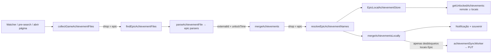

# LBX-1070 — Parsing local de conquistas de jogos Epic Games Store

Issue: [LBX-1070](https://linear.app/los-broxas/issue/LBX-1070/add-support-for-achievement-parsing-on-epic-games-store-titles) · Projeto: Epic Games Store Catalogue Integration · Milestone: Achievement parsing Support

## Contexto e objetivo

O Hydra já detecta conquistas de jogos Steam lendo arquivos que emuladores escrevem no disco e notifica o desbloqueio durante o jogo. Jogos Epic não têm esse caminho: as conquistas Epic chegam apenas pela importação da conta Epic (`src/main/services/epic/achievement-source.ts`).

A issue pede o mesmo comportamento da Steam para títulos Epic:

1. Ler `achievements.json` do emulador Nemirtingas em `%APPDATA%\NemirtingasEpicEmu\<usuário>\<namespace>\achievements.json`.
2. Ler o `data.chunk` do Alan Wake 2 (motor Northlight) em `<AppData>\Remedy\AlanWake2\<usuário>\achievements\data.chunk`. O arquivo não tem horário de desbloqueio, então o horário registrado é o momento em que o Hydra o observou.
3. Notificar novos desbloqueios em jogo e sincronizá-los com o perfil, como acontece com a Steam.

O PR anterior ([hydralauncher/hydra#2844](https://github.com/hydralauncher/hydra/pull/2844)) foi aprovado, mas fechado sem merge. Ele mirava `codex/epic-catalogue-launcher`, uma branch que não existe mais na `main`. Desde então a `main` ganhou a importação de conquistas da conta Epic e uma guarda que bloqueia o merge local de jogos Epic. Por isso, este design reaproveita os parsers e as validações do #2844, mas refaz a integração em cima dessa guarda.

## Escopo

- Descoberta dos arquivos Nemirtingas e Alan Wake 2 no Windows e em prefixos Wine (Linux), incluindo um `savepath` relativo configurado em `NemirtingasEpicEmu.json` dentro da pasta do jogo.
- Parsers estritos para os dois formatos, que rejeitam escritas parciais.
- Resolução dos IDs da Epic (`externalId`) para o `name` da definição do catálogo Hydra.
- Watcher em tempo real, varredura inicial (pre-search), notificação, souvenir e sync com `PUT /profile/games/achievements`.
- Reset de conquistas apagando os arquivos locais Epic.

## Fora de escopo

- Outros emuladores Epic. A issue afirma que o Nemirtingas é o único com suporte a conquistas.
- Outros jogos Northlight além do Alan Wake 2. O layout é do motor, mas os limiares e o mapeamento por posição foram verificados só para o AW2.
- Hook em tempo de execução no EOS SDK, overlay e escrita de conquistas na Epic.
- Mudanças na API. O contrato atual já atende (detalhes abaixo).

## Estado atual

| Etapa                | Arquivo                                                                                     | Observação                                                                                                                                                                             |
| -------------------- | ------------------------------------------------------------------------------------------- | -------------------------------------------------------------------------------------------------------------------------------------------------------------------------------------- |
| Descoberta           | `src/main/services/achievements/collect-game-achievement-files.ts`                          | Retorna `[]` para qualquer loja que não seja `steam`.                                                                                                                                  |
| Caminhos por cracker | `src/main/services/achievements/find-achievement-files.ts`                                  | Tabela `Cracker → pasta/arquivo`; caminhos relativos ao prefixo no Wine.                                                                                                               |
| Parsing              | `src/main/services/achievements/parse-achievement-file.ts` e `parse-achievement-formats.ts` | `ACHIEVEMENT_PARSERS: Record<Cracker, parser>`; erro vira `[]`.                                                                                                                        |
| Watcher              | `src/main/services/achievements/achievement-watcher-manager.ts`                             | Compara `mtime` por arquivo e chama `mergeAchievements(game, unlocks, true)`. `firstSyncWithRemoteIfNeeded` ignora `epic`.                                                             |
| Merge e sync         | `src/main/services/achievements/merge-achievements.ts`                                      | Deduplica contra `AchievementMemoryStore`, notifica, captura souvenir e enfileira `achievementSyncWorker` com a lista inteira em memória. `mergeAchievements` retorna `0` para `epic`. |
| Upload               | `src/main/services/achievements/achievement-sync-worker.ts`                                 | `PUT /profile/games/achievements` com `{ id: remoteId, achievements }`.                                                                                                                |
| Leitura              | `src/main/events/user/get-unlocked-achievements.ts`                                         | Para `epic`, quando a API responde, usa só `remote.unlocked` e descarta a memória local.                                                                                               |
| Reset                | `src/main/events/library/reset-game-achievements.ts`                                        | Apaga os arquivos de `collectGameAchievementFiles` e as conquistas Hydra no servidor.                                                                                                  |

A guarda Epic em `mergeAchievements` tem uma razão, documentada em `docs/epic-achievements-sync-sdd.md` (commit `3cd0cf0f4`). Para jogos Epic, a memória contém desbloqueios importados da conta Epic. O merge genérico reenviaria esses desbloqueios como origem Hydra. Este design mantém essa garantia.

### Contrato da API (verificado em `hydra-api` na `origin/main`)

- `PUT /profile/games/achievements` só insere ou atualiza (`upsertIncomingAchievements`, `skipDuplicates`). Nunca remove o que está ausente do payload.
- O PUT compara pelo `name` da definição (`epic_<hash>`), sem diferenciar maiúsculas. Ele não usa o `externalId` da Epic.
- Jogos Epic com `source === "epic"` (importados da biblioteca Epic) são rejeitados com `400 achievements/imported-source`. Jogos Epic adicionados pelo Hydra são aceitos.
- `GET /games/epic/:objectId/achievements` expõe `externalId`, que é o `name` bruto da conquista na Epic, e `externalSetId`, que é o `achievementSetId`.
- A leitura remota devolve juntos os desbloqueios Hydra e os importados da Epic.

## Design proposto

### Componentes

Novos módulos em `src/main/services/achievements/epic/`:

| Arquivo                             | Responsabilidade                                                                                                                                     | Dependências                        |
| ----------------------------------- | ---------------------------------------------------------------------------------------------------------------------------------------------------- | ----------------------------------- |
| `epic-achievement-parsers.ts`       | Ler o arquivo de forma estável e fazer o parsing de Nemirtingas e AW2. Devolve `EpicLocalUnlock[]` ou `null` quando o arquivo é inválido ou parcial. | Somente `node:fs` (puro, testável). |
| `find-epic-achievement-files.ts`    | Dadas as raízes Roaming/Local e o `objectId`, descobrir os arquivos e escolher um perfil por fonte.                                                  | `node:fs/promises`.                 |
| `nemirtingas-save-root.ts`          | Ler `NemirtingasEpicEmu.json` e resolver um `savepath` relativo, que não pode sair da pasta do jogo.                                                 | `node:fs`.                          |
| `resolve-epic-achievement-names.ts` | Mapear `externalId` para `name` da definição; um ID ambíguo não é resolvido.                                                                         | Puro.                               |
| `epic-local-achievement-store.ts`   | Guardar em memória, durante a sessão, os desbloqueios Epic observados localmente. Esse é o único conjunto que vai para o upload.                     | Puro.                               |
| `epic-achievement-files.ts`         | Montar as raízes de Windows e Wine com `SystemPath`/`Wine` e expor `findEpicAchievementFiles(game)`.                                                 | Electron (cola, sem lógica).        |

`Cracker` ganha `nemirtingas = "Nemirtingas"` e `alanWake2 = "AlanWake2"`. Com isso `AchievementFile`, `parseAchievementFile` e o reset funcionam sem um novo tipo. Os dois valores não entram na lista `crackers` de `find-achievement-files.ts`, então a varredura Steam não muda.

### Fluxo de dados

1. `collectGameAchievementFiles` delega para `findEpicAchievementFiles` quando `shop === "epic"`.
2. O parser devolve desbloqueios com `name = externalId` bruto. Quando o arquivo é inválido, o watcher grava `mtime = -1` para tentar de novo no próximo ciclo, em vez de tratar o arquivo como vazio.
3. Para jogos Epic, `mergeAchievements` usa um caminho próprio:
   - carrega as definições (`getGameAchievementData`, com cache) e resolve `externalId → name`;
   - registra os resolvidos no `EpicLocalAchievementStore`, mantendo o horário da primeira observação;
   - chama o mesmo `mergeAchievementsLocally`, passando como conjunto de upload apenas o conteúdo do store local. Os desbloqueios importados da Epic nunca entram no payload;
   - não faz upload quando `game.source === "epic"`, porque a API rejeitaria com 400. A notificação e a exibição local continuam.
4. `mergeAchievements(game, [], false)`, chamado no pre-search e no fluxo "remote behind", só reenfileira o store local. Quando o store está vazio, retorna `0` como hoje, e a guarda original continua valendo para todo jogo Epic sem arquivos locais.
5. Para Epic, `getUnlockedAchievements` passa a exibir `remote.unlocked ∪ store local` (`mergeUnlockedAchievementLists`). Assim um desbloqueio ainda não confirmado não some da tela, e o watcher não o trata como novo de novo (o que geraria notificação duplicada).
6. `firstSyncWithRemoteIfNeeded` deixa de ignorar `epic`. Ele lê os arquivos sem notificar e passa pelo mesmo caminho Epic.

### Mapeamento dos campos

| Campo Hydra                                     | Nemirtingas `achievements.json`                                                                    | Alan Wake 2 `data.chunk`                                                           |
| ----------------------------------------------- | -------------------------------------------------------------------------------------------------- | ---------------------------------------------------------------------------------- |
| Identificador                                   | `AchievementId` → `externalId` da definição → `name`                                               | posição `n` (base 1) → `externalId` `"n"` ou `"ACH_n"` → `name`                    |
| Desbloqueado                                    | presença na lista com `UnlockTime > 0`                                                             | `stepsCurrent ≥ limiar` (tabela verificada; limiar 1 para as demais posições ≤ 88) |
| Data de desbloqueio                             | `UnlockTime` (segundos) × 1000                                                                     | `Date.now()` da primeira observação, mantido no store                              |
| Nome, descrição, ícone, pontos/raridade, oculta | definição do catálogo Hydra (`displayName`, `description`, `icon`, `icongray`, `points`, `hidden`) | igual                                                                              |

Os textos localizados vêm do catálogo no idioma do usuário, como na Steam. Uma conquista oculta continua com a descrição escondida enquanto estiver bloqueada (`showHiddenAchievementsDescription`). A raridade usa os mesmos `points` e `isRareAchievement` das notificações Steam.

### Regras dos parsers

**Nemirtingas**

- O arquivo deve ser UTF-8 válido com um array JSON de objetos `{ AchievementId: string, UnlockTime: inteiro ≥ 0 }`, com até 10.000 itens.
- O arquivo inteiro é rejeitado se houver ID duplicado, ID vazio ou com mais de 512 caracteres, caractere de controle, ou horário no futuro.
- `UnlockTime === 0` é ignorado, porque significa conquista ainda não desbloqueada.

**Alan Wake 2 (Northlight)**

- O header deve ter `version = 1` e o tamanho exato `8 + count × 16`. Isso detecta uma escrita parcial.
- Todo registro deve ter `type = 2`.
- O `m_id` de cada posição de 1 a 88 deve bater com a tabela de faixas do catálogo. É uma checagem de consistência.
- Posições acima de 88 são ignoradas, porque não têm limiar verificado. Um falso desbloqueio seria permanente.
- Os limiares maiores que 1 vêm da tabela da issue: 10:5, 11:6, 12:8, 20:5, 34:13, 59:17, 60:43, 63:14, 69:3, 73:6, 81:5, 85:4, 87:37.
- Se o `count` for menor que 88 (jogo base sem DLC), só os registros presentes são lidos.
- Antes de fazer o parsing, o arquivo `--containerDisplayName.chunk` precisa ler exatamente `achievements`.
- A descoberta procura em `%LOCALAPPDATA%` (onde o motor grava, segundo o documento anexo à issue) e em `%APPDATA%` (o caminho citado na issue).
- O AW2 é identificado pelo namespace `c4763f236d08423eb47b4c3008779c84` do `objectId` (`namespace:catalogItemId`).

**Leitura estável:** o arquivo é aberto sem seguir symlink, com limite de 2 MiB. O tamanho e o `mtime` são comparados antes e depois da leitura; se mudaram, o resultado é `null` e o watcher tenta de novo.

### Perfis múltiplos

O `<usuário>` muda conforme a instalação. Quando há mais de um perfil com arquivo, o arquivo usado é o que tem o `mtime` mais recente, um por fonte. Esse é o perfil ativo do jogo.

O #2844 descartava a fonte inteira nesse caso. Isso deixava sem conquistas quem tem pastas antigas, como `Default-Epic-User` ao lado do ID real. Somar todos os perfis misturaria o progresso de pessoas diferentes.

## Casos de borda e tratamento de erros

| Caso                                                    | Comportamento                                                                                                                                                                              |
| ------------------------------------------------------- | ------------------------------------------------------------------------------------------------------------------------------------------------------------------------------------------ |
| Jogo sem conquistas, catálogo vazio ou jogo sem suporte | Os IDs não são resolvidos: nada é notificado nem enviado. O arquivo é marcado para nova leitura, e a resolução acontece quando o catálogo for atualizado (por exemplo, ao abrir a página). |
| ID que aparece em mais de um `externalSetId`            | É ambíguo e não é resolvido. Nunca há associação por título, posição ou ícone.                                                                                                             |
| Arquivo ausente (reset ou jogo nunca executado)         | Nenhuma contribuição. Não é erro e não apaga nada.                                                                                                                                         |
| Escrita parcial ou JSON truncado                        | O parser devolve `null` e o watcher tenta de novo no próximo ciclo.                                                                                                                        |
| Sessão Hydra expirada ou troca de conta                 | Fica a cargo do `achievementSyncCoordinator` e do `achievementSyncWorker` (contexto de autenticação, cancelamento e retry com backoff). Nenhuma credencial Epic é usada.                   |
| Rate limit, 5xx ou rede                                 | O worker existente mantém o item pendente, faz retry com backoff (`getAchievementSyncRetryDelay`) e honra `Retry-After`.                                                                   |
| `400 achievements/imported-source`                      | Evitado na origem: jogos com `source === "epic"` não fazem upload.                                                                                                                         |
| Resposta parcial do PUT                                 | Nomes fora do catálogo são descartados pela API. O próximo upload reenvia o conjunto local completo, porque o PUT é idempotente.                                                           |
| Localização                                             | O catálogo é pedido no idioma configurado. Os IDs Epic não dependem de idioma.                                                                                                             |
| Conquistas ocultas                                      | Seguem a preferência `showHiddenAchievementsDescription`. A notificação usa `isHidden` da definição.                                                                                       |
| Horário sem fonte (AW2)                                 | É o horário da primeira observação, mantido entre leituras. Se o Hydra estava fechado, o horário é o da primeira leitura.                                                                  |
| `savepath` absoluto ou fora da pasta do jogo            | É ignorado com um aviso, e a fonte Nemirtingas é descartada.                                                                                                                               |
| Reset                                                   | Apaga os arquivos Epic locais (o jogo recria o `data.chunk` zerado), limpa o store local e mantém os desbloqueios importados da conta Epic.                                                |

## Estratégia de testes

Os testes são unitários com `node:test`, seguindo `*.test.ts` ao lado do código. As fixtures reais anexadas à issue ficam em `src/main/services/achievements/epic/fixtures/`.

- **Parsers:** a fixture Nemirtingas; `UnlockTime 0`; duplicatas; tipos inválidos; horário no futuro; JSON truncado. A fixture AW2 deve devolver `3`, `32` e não `63` (parcial 1/14). Também: count reduzido, tamanho incorreto, `type ≠ 2`, `m_id` divergente, limiar alcançado e arquivo mudando durante a leitura.
- **Descoberta:** árvore temporária com vários perfis (escolhe o mais recente), namespace diferente, `--containerDisplayName.chunk` ausente ou inválido, objectId que não é do AW2, raízes Local e Roaming, `savepath` relativo, absoluto e com `..`.
- **Resolução:** correspondência exata; `n` contra `ACH_n`; ID ambíguo entre conjuntos; definição sem `externalId`.
- **Store local:** mantém o primeiro horário, lista por jogo e limpa no reset e na troca de sessão.
- **Comandos:** `yarn lint`, `yarn typecheck`, `yarn format-check` e `yarn test` antes de cada push.

## Riscos e alternativas

| Risco                                                                                             | Mitigação                                                                                           |
| ------------------------------------------------------------------------------------------------- | --------------------------------------------------------------------------------------------------- |
| O formato de `externalId` do AW2 não foi confirmado (`"38"` no Nemirtingas, `ACH_38` no binário). | A resolução tenta as duas formas e exige correspondência única. Se nenhuma bater, nada é enviado.   |
| Um falso desbloqueio por limiar errado é permanente.                                              | A tabela é verificada; posições sem limiar conhecido são ignoradas, e `m_id` é checado por posição. |
| Upload de importações Epic como origem Hydra.                                                     | O payload Epic vem só do store local, e há teste cobrindo isso.                                     |
| Perfil errado escolhido em máquina compartilhada.                                                 | É usado o perfil mais recente, e o reset permite corrigir.                                          |

Alternativas consideradas:

1. Portar o #2844 sem mudanças. Ele não conhece a importação de conquistas Epic e reenviaria a memória inteira.
2. Remover a guarda Epic de `mergeAchievements`. Isso quebraria a garantia do SDD de sincronização Epic.
3. Usar o `mtime` como horário do AW2. Ele é reescrito a cada flush e mudaria a cada leitura; manter a primeira observação é estável.

## Rollout

Não há feature flag: a funcionalidade só age quando os arquivos existem, e o caminho Steam fica intacto.

1. Merge na `main` e publicação no próximo release.
2. Validação manual no Windows com o AW2 sob Nemirtingas: abrir o jogo, desbloquear, ver a notificação, ver o item no perfil, fazer o reset.
3. Monitorar logs `achievements` com o prefixo `Epic` e erros 4xx do PUT.
4. Reverter é um revert do PR, sem migração de dados.
